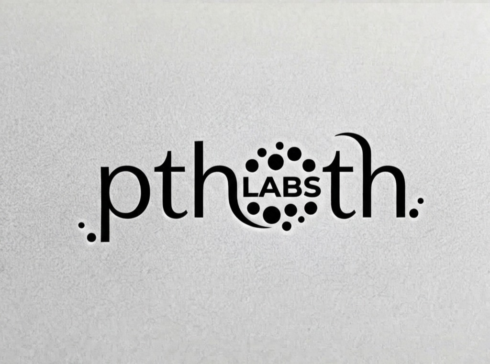
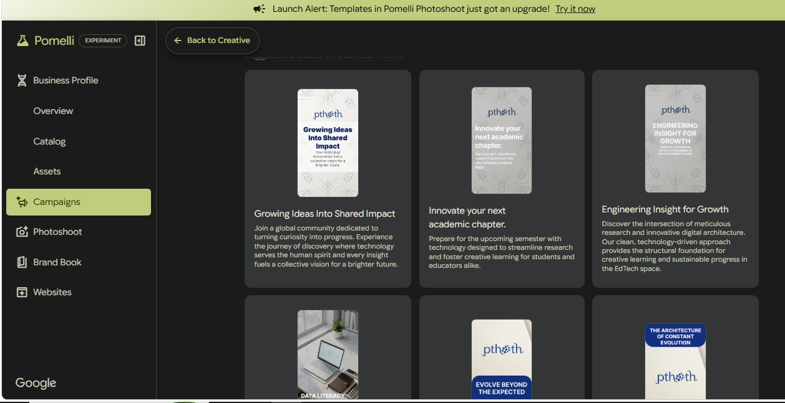

+++
contributor = "rakshita-pawar"
title = "Rakshita Pawar - Week 2"
date = 2026-10-17
draft = false
author = "Rakshita Pawar"
role = "Social Media Manager"
week = 2
emoji = "👩‍💻"
+++



## 👩‍💻 Rakshita Pawar

### Week 2: Building the PTHOTH Labs Visual Identity

*Social Media Manager · Internship Journal, Week 2*

Week 2 focused on developing a recognisable visual identity for PTHOTH Labs. As Social Media Manager, my work was not only about publishing content, but also about helping establish how the organisation would present itself visually across its digital platforms. The logo and supporting brand elements were an important part of creating a consistent and professional presence.

#### Working on the PTHOTH Labs Logo

The main focus this week was exploring the PTHOTH Labs logo and considering how it could represent the organisation in a clean, memorable way. The design places the name at the centre, with a dotted, connected motif that gives it a technology-oriented character. While reviewing the logo, I considered how clearly it communicates the brand and how it might appear on different backgrounds, social media posts, and other digital materials. A logo needs to be recognisable on its own while also fitting naturally into a wider visual identity.

*Figure 2.1: PTHOTH Labs logo concept explored during Week 2.*

#### Exploring Brand Elements with Pomelli Labs

To explore how the logo could translate into a broader brand style, I used Pomelli Labs, a web-based creative tool. I reviewed the brand-inspired designs and campaign concepts displayed in its workspace. The examples included academic, research, and technology-focused layouts, offering visual references for how a brand can maintain a consistent look across different types of posts. This helped me think beyond the logo itself and consider typography, colour combinations, logo placement, backgrounds, and supporting graphics as parts of one connected identity.

*Figure 2.2: Pomelli Labs workspace showing creative concepts developed around the PTHOTH Labs brand.*

#### Key Design Considerations

While reviewing the logo and brand-inspired designs, I focused on a few principles that can help PTHOTH Labs maintain a clear and consistent presence:

- **Consistency:** The logo, typography, colours, and graphic details should feel connected across posts and platforms.
- **Clarity:** The organisation's name and the main message should remain easy to recognise, even in smaller designs.
- **Professionalism:** Clean layouts can help communicate PTHOTH Labs' focus on education, research, and technology.
- **Flexibility:** The visual elements should work for different content types, including announcements, learning resources, and research updates.
- **Recognisability:** Repeating a considered set of visual elements can help audiences associate posts with PTHOTH Labs.

#### Learning & Outcome

This week helped me understand that branding involves more than creating an attractive logo. A strong visual identity comes from the way the logo, colour palette, typography, and layouts work together. Exploring Pomelli Labs gave me a way to review different creative directions and gather ideas for how PTHOTH Labs could present its work more consistently. It also highlighted the importance of choosing design elements that support the organisation's purpose rather than adding decoration without meaning.

The work during Week 2 was an exploratory step toward a more cohesive visual style for PTHOTH Labs' social media presence. The concepts and references can help guide future designs and make the organisation's content feel connected from one post to the next.

#### Next Steps

- Refine the preferred logo direction and check its readability at different sizes.
- Establish a consistent colour palette and typography for social media designs.
- Create reusable templates for announcements, educational content, and research-related updates.
- Check that the logo and layouts remain legible across light and dark backgrounds.
- Keep future designs clean, educational, and recognisable across PTHOTH Labs' platforms.
