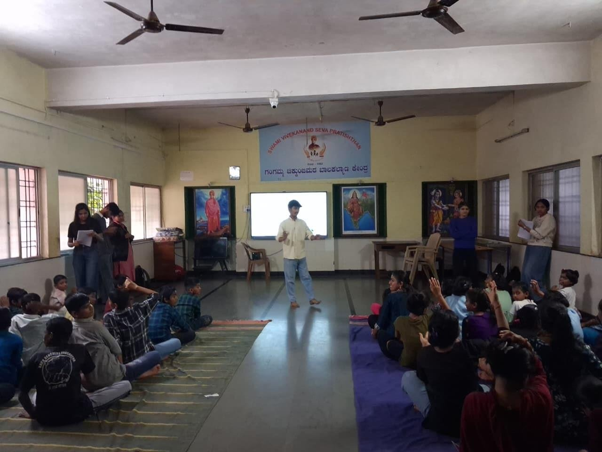
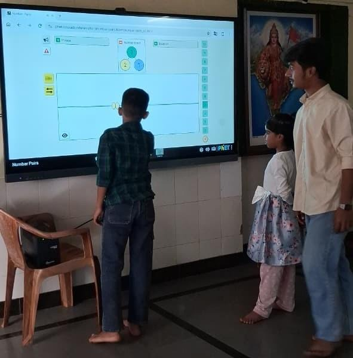

+++
contributor = "vishwas-karikatti"
title = "Vishwas Karikatti - Week 2"
date = 2026-10-17
draft = false
author = "Vishwas Karikatti"
role = "Teacher Intern"
week = 2
emoji = "👨‍🏫"
+++



## 👨‍🏫 Vishwas Karikatti

### Week 2: Growing Into the Role of a Teacher

*Teacher Intern · Internship Journal, Week 2*

**Branch:** Robotics and Artificial Intelligence
**College:** Maratha Mandal Engineering College
**Organisation:** Pthoth, in collaboration with Swami Vivekanand Seva Pratisthan (SVSP), Belagavi

#### Introduction

The first week was about understanding what teaching involves. In the second week, I tried to apply what I had learned. I was more comfortable in front of the students, better prepared, and more focused on whether they were actually understanding the lesson.

#### Objectives for the Week

- To build on the activities from Week 1 and improve how I explain concepts.
- To involve more students in each session, especially the quieter ones.
- To use feedback from mentors to improve my lessons.

#### Activities Undertaken

**Classroom sessions.** Sessions were again held in the hall of the Kendra, with the students seated together on mats. This time I planned my questions in advance and tried to give every student a chance to answer, not only the ones who raised their hands first.

*Figure 1: Conducting an interactive session for the students at the SVSP Kendra.*

**Interactive tools and games.** I continued to use the smart board with PhET simulations and Math Playground games. Students came up to the board to try activities themselves while the others watched and discussed. I also used quizzes from National Geographic Kids to check understanding in a light, low-pressure way.

*Figure 2: A student solving the PhET Number Pairs activity on the smart board.*

#### What I Learned

- Preparing a clear plan and a simple example beforehand makes the session run smoothly.
- Short explanations followed by a question work better than long talking.
- A wrong answer is useful because it shows exactly where the confusion is.
- Quiet students need encouragement and patience, not pressure.
- Feedback from mentors helps me see things I cannot notice myself.

#### Challenges and Improvements

Managing the pace of a session was my main challenge. Some students were quick, while others needed an extra example. Going forward, I plan to prepare a second way of explaining each idea and to keep a few extra questions ready for students who finish early.

#### Resources

- [Resource 1](https://share.google/0aqfop7T59uAMzGgE)
- [Resource 2](https://share.google/s7UCMz4ZFenalFxzh)

#### Key Takeaway

Week 2 showed me that teaching improves with practice and reflection. Small changes, such as a better question or a clearer example, make a visible difference. I look forward to continuing to learn from my students and mentors in the coming weeks.