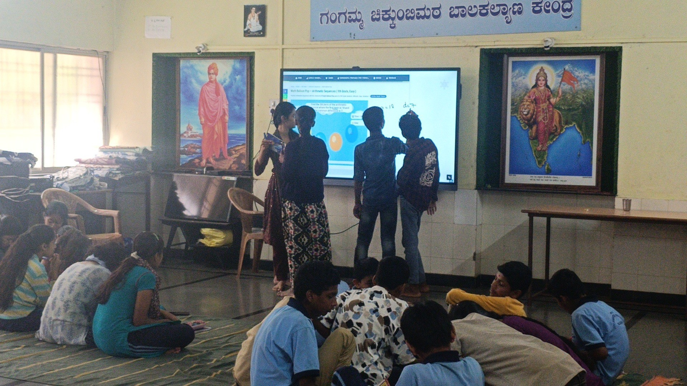

+++
contributor = "pavitra-madiwal"
title = "Pavitra Madiwal - Week 3"
date = 2026-10-17
draft = false
author = "Pavitra Madiwal"
role = "Content Creator"
week = 3
emoji = "✨"
+++



## ✨ Pavitra Madiwal

### Week 3: Social Media Strategy & Automation

*Content Creator Logbook · Week 3*

✨ **Creator Notes — Week 3:** While waiting for our new workstation laptop to be assigned, I took the initiative to research next-gen social media scheduling tools. I stumbled upon Postiz online, an open-source platform promising automated post scheduling, AI content helpers, and full platform control. I decided to try setting it up locally on Docker!

#### 1. Discovering Postiz & the Open-Source Dream

As a content creator, managing multiple social platforms manually takes away hours of creative time. During my online research, I discovered Postiz (an open-source social media management tool supporting X, LinkedIn, Instagram, TikTok, and YouTube). Its sleek feature set instantly grabbed my attention.

**✨ What Hooked Me (Features)**

- Visual drag-and-drop content calendar.
- AI Copilot for quick post caption generation.
- Centralized cross-posting to 10+ social networks.
- 100% free open-source software (AGPL-3.0).

**🎯 Creator Goals for Week 3**

- Explore Postiz web documentation and architecture.
- Test a local Docker installation on available system.
- Verify if self-hosted scheduling works without costs.
- Set up an automated calendar pipeline.

#### 2. Hands-On Attempt: Docker Terminal Setup

I opened the terminal and followed the official Postiz Docker Compose guide. I cloned the repository and attempted to start the full stack (PostgreSQL database, Redis cache, Temporal background worker, and Next.js frontend).

```bash
# Cloned the official Postiz Docker repo
$ git clone https://github.com/gitroomhq/postiz-docker-compose.git
$ cd postiz-docker-compose

# Attempting to start the containers
$ docker compose up -d
[+] Running 4/4
 ✔ Container postiz-postgres  Healthy
 ✔ Container postiz-redis     Healthy
 ✘ Container postiz-app       Error: exit code 1
FATAL: DATABASE_URL environment variable missing or invalid.
Error: Temporal worker connection failed (localhost:7233 connection refused).
```

#### 3. Tech Bumps & Configuration Errors Hit

While Postiz looks incredible as a product, self-hosting proved to be surprisingly technical for a content creator workflow:

- ❌ **Environment variable errors blocked the setup.** The local container failed to start because the `.env` variables for PostgreSQL passwords and JWT encryption secrets were missing or unconfigured.
- ⚠️ **Social app developer keys are complex.** To post to Instagram or Meta, self-hosted Postiz requires registering custom Developer Apps on the Meta and LinkedIn portals, which means domain verification and OAuth setup.

#### 4. Classroom Photos

Photographs from the classroom sessions this week.


*Figure 3.1: Two students working together on a written task.*



*Figure 3.2: Students at the smart board during the session.*
