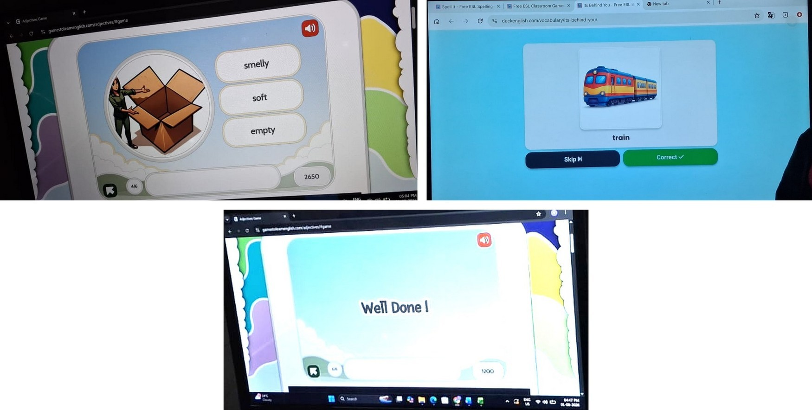
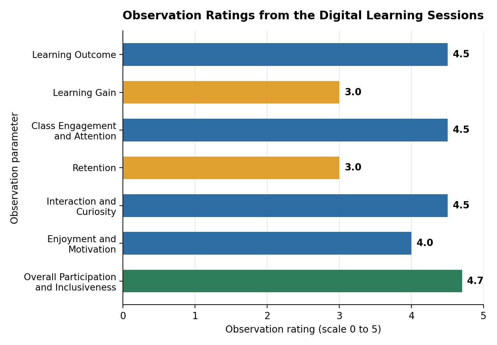

+++
contributor = "shreya"
title = "Shreya Hebbalkar - Week 3"
date = 2026-10-17
draft = false
author = "Shreya Hebbalkar"
role = "Researcher and Documentation Intern"
week = 3
emoji = "🔬"
+++



## 🔬 Shreya Hebbalkar

### Learning Through Digital Games: My Research and Classroom Observations

*Researcher and Documentation Intern · Research Article, Week 3*

**College:** Maratha Mandal Engineering College, Belagavi
**Organisation:** Pthoth, in collaboration with Swami Vivekanand Seva Pratisthan (SVSP), Belagavi
**Website used:** Games to Learn English

#### Turning Classroom Observations into Research

As a Researcher and Documentation Intern at Pthoth, in collaboration with SVSP, Belagavi, I had the opportunity to observe students from Classes 6 to 10 taking part in digital learning activities on nouns, adjectives, sentence formation and continents.

The purpose of my research was to observe student engagement, participation, collaboration, communication and learning behaviour. I was not there to teach. My task was to watch carefully, listen, and record what I saw as accurately as I could.

#### My Research Method and Observation Process

During the session, I recorded student behaviour, participation, responses and interactions in a structured observation diary. After the session, I held discussions to understand more about what had happened and to check my notes against what students and others involved had experienced.

This process taught me that documentation is a large part of research. The value of the findings in this article depends on how carefully the observations were collected and recorded, so I focused on noting what students actually did and said rather than what I expected to see. In this article, I have tried to keep my direct observations, my interpretations and my recommendations clearly separate.

#### What I Observed During the Learning Session

*Figure 1: Digital learning activities used during the session.*

Using the Games to Learn English website, I observed the following:

- Students explored the games with curiosity and enthusiasm.
- They discussed answers with classmates and helped one another.
- Most students followed instructions independently after receiving initial guidance.
- Friendly competition encouraged participation.
- Some students answered confidently after encouragement.
- A few students struggled with spelling and writing English words and needed additional support.

I noticed that students were more willing to try, and to try again, when the activity felt like a game. The friendly competition seemed to push them to take part, and I saw students turn to each other for help instead of waiting for an adult. At the same time, I observed that some students only answered confidently once they had been encouraged, which showed me how much a supportive environment matters.

#### Differences Between Age Groups

I observed clear differences between students in Classes 6–7 and those in Classes 8–10. The younger students showed greater excitement, but they needed more guidance with spelling and sentence formation. The older students generally completed the activities faster and collaborated more independently.

These differences taught me that a digital learning activity cannot be judged in the same way for every group. An activity that is exciting for one age group may be too easy or too difficult for another, so students' learning levels need to be considered when evaluating such activities.

#### Graphs and Observation Ratings

The report recorded observation ratings out of 5 for seven parameters. These are observation ratings, not percentages of students who learned successfully, and I have not converted them into percentages or added any other data.

*Graph 1: Observation ratings (out of 5) recorded for the digital learning sessions.*

Overall Participation and Inclusiveness received the highest rating (4.7). Learning Outcome, Class Engagement and Attention, and Interaction and Curiosity were each rated 4.5, and Enjoyment and Motivation was rated 4.0. Learning Gain and Retention received the lowest ratings, at 3.0 each.

#### Understanding Student Learning and Engagement

The ratings and my classroom experience suggest that students were highly engaged, curious and willing to collaborate, and that they enjoyed the activities. The ratings for learning gain and retention were lower than those for engagement, which suggests that high engagement and lasting learning are not the same thing.

I also noticed that students could recall concepts that were familiar to them, but sometimes struggled when a question was unfamiliar. This is my interpretation of what I observed.

It is important to be clear about the limits of these findings. The report relied on classroom observations and did not include a formal assessment, so it cannot establish long-term learning improvement.

#### Challenges I Identified as a Researcher

The challenges documented in the report were:

- Difficulties with spelling and writing.
- Challenges with unfamiliar questions.
- The need for additional support with English vocabulary and sentence formation.
- Occasional distractions from nearby classrooms.
- Differences in students' confidence and participation.

Identifying these challenges helped me understand that engagement alone does not fully measure learning. A student can be enthusiastic and active in a session and still find it hard to spell a word or answer a question they have not seen before.

#### What I Learned Through This Research

This experience taught me a great deal about research and about myself as a researcher.

I learned to observe student behaviour carefully rather than make assumptions. It is easy to decide that a lively classroom means students are learning well, but when I wrote down what I actually saw, the picture was more detailed than that.

By keeping structured notes, I began to see patterns in engagement and participation. I understood the differences between younger and older students, and I recognised how important collaboration and encouragement are. Seeing students help one another, and seeing quieter students answer more confidently once they were encouraged, showed me how much a supportive atmosphere affects participation.

Most importantly, I learned to distinguish participation from actual learning outcomes. Using structured observations and ratings helped me document my findings in an organised way, and it also showed me which areas need further investigation, such as retention. I realised that research findings like these can guide improvements in digital learning activities.

During my research work, I was also introduced to Free and Open Source Software (FOSS). Learning about it made me think more carefully about the digital educational resources I come across, including how accessible they are and how they are licensed. I have not assessed the licensing or technical characteristics of the website used in this session.

#### Recommendations for Future Learning Sessions

The points below are my recommendations based on the report. They are not findings that have already been observed.

- Provide additional spelling and writing practice.
- Support students who struggle with English vocabulary and sentence formation.
- Conduct similar sessions using different topics.
- Use short quizzes alongside observation ratings.
- Observe learning outcomes over multiple sessions.
- Continue documenting student engagement and participation.

#### My Key Takeaway

This research experience helped me understand how digital learning, student engagement, collaboration and learning outcomes are connected. Digital games can bring curiosity, enjoyment and teamwork into a classroom, but engagement does not automatically mean lasting learning. Without further observation and assessment over time, I cannot say how much students retained.

I have also come to see that a researcher's role is to observe carefully, analyse the evidence, document the findings, and identify ways to improve educational activities. This experience has strengthened my skills in observation and documentation, and it has been an important step in my growth as a Researcher and Documentation Intern.
