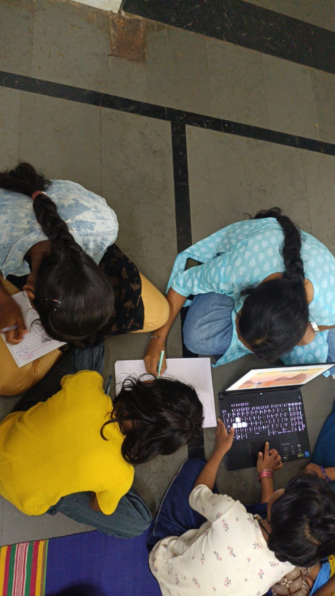
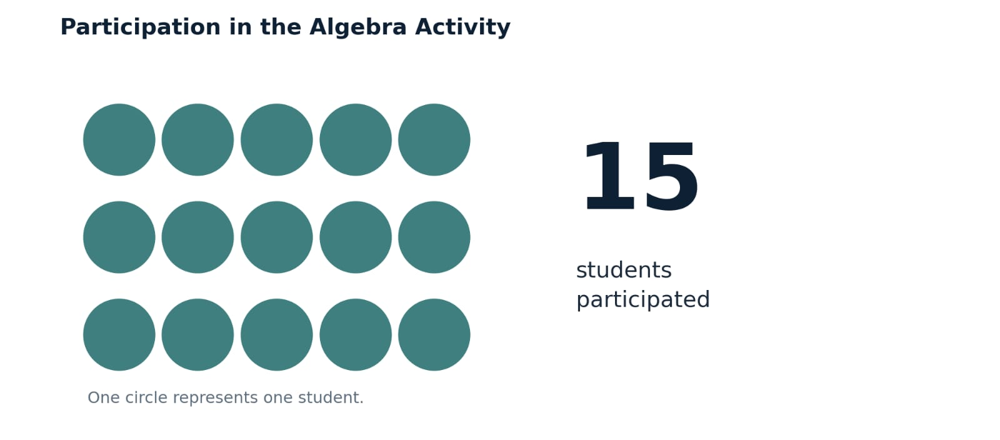

+++
title = 'Who Is Doing the Thinking?'
date = '2026-10-23T09:00:00-07:00'
draft = false
week = 3
weight = 1
contributor = 'sneha'
emoji = '🔬'
role = 'Researcher & Documentation Intern'
description = 'Exploring hints, peer support and independent thinking in a digital algebra activity.'
+++



### Who Is Doing the Thinking?

*Exploring hints, peer support and independent thinking in a digital algebra activity.*

**By Sneha Gurav**
*Robotics and AI student, documentation intern at Pthoth × SVSP*

## 01 | A Number That Tells Me Least

Fifteen students participated in an algebra activity using a digital learning game. The session followed Pair-Based Learning, allowing students to engage with the activity alongside their partners.

As a researcher and documentation intern, I was interested in more than participation. Algebra requires students to understand the steps behind an answer, not simply reach the correct result. This raised a question worth exploring: when students solve algebra problems in pairs using a digital game, how much of the thinking comes from individual understanding, peer support or guidance from the game?

The session gave me a starting point for examining this question. Understanding how students reached their answers would require more structured observation.

## 02 | What Algebra Asks of a Student

In algebra, the final answer does not always reveal how a student reached it. A student may understand each step, follow a familiar pattern, use a digital hint or rely on a partner's explanation. These different approaches can sometimes lead to the same answer.

For this reason, I would focus on four aspects of problem-solving:

- **Reasoning:** Can the student explain why a step is needed?
- **Peer support:** Does the partner explain the process or simply provide the answer?
- **Error correction:** Can the student identify and correct a mistake?
- **Independent application:** Can the student solve a comparable problem without help?

These indicators would help distinguish reaching an answer from understanding the concept behind it. They are proposed areas for future observation, not results recorded during this session.

## 03 | What Pairs and Games Can Show and Hide

Pair-Based Learning creates opportunities for students to explain ideas, compare approaches and correct one another's mistakes. However, working together does not automatically mean that both students contribute equally. One partner may explain the reasoning while the other follows, or both may contribute to solving the problem. Distinguishing between these possibilities is important when examining individual understanding.

*Figure 1. Students seated around a laptop during the session.*

A digital learning game introduces another influence: the support provided by the tool itself. Hints and immediate feedback may help students move past difficulties and recognise errors. However, a correct response after a hint does not necessarily show that a student could solve the same problem independently.

These are possibilities to investigate, rather than conclusions about what occurred in this session. Future observations should therefore consider both the interaction between partners and the support provided by the game.

## 04 | What the Session Shows, and What It Does Not

The confirmed participation figure is fifteen students. This is the information available to document quantitatively from the session.

*Figure 2. Student participation in the algebra activity. Each circle represents one participant. The figure presents participation only; it does not measure conceptual understanding, peer assistance, individual contribution or independent problem-solving.*

This distinction matters when evaluating digital learning activities. Participation tells us who took part, but it does not establish how effectively students learned. Similarly, completing a digital task does not, on its own, demonstrate that a student understands the steps or can apply the concept independently.

The session therefore provides a starting point for further investigation, rather than evidence that the method was effective or ineffective. A structured observation process would make it possible to examine students' reasoning, interactions and independent application more carefully in future sessions.

## 05 | How I Would Observe Next

The questions raised by this activity can guide a more structured approach to future sessions. The following framework is a proposed method; these indicators were not measured during the session described in this article.

**Table 1. Proposed Observation Framework for Future Sessions**

| Indicator | What to record |
|---|---|
| Peer interaction | Number of task-related exchanges between partners |
| Peer assistance | Instances where a partner explains a step or supplies an answer |
| Participation balance | Problem attempts and explanations contributed by each partner |
| Digital hints | Number of hints used and whether the student attempts the next step independently |
| Error correction | Whether the student identifies and corrects an error after feedback |
| Independent problem-solving | Whether each student solves a comparable problem individually |

A comparable individual problem after the paired activity could help examine whether students can apply the concept without immediate assistance. The problem should test the same underlying algebraic idea without simply repeating the original question.

During future sessions, I would also record the number of students, group arrangements and any changes to the activity. With fifteen participants, the grouping arrangement should be documented accurately rather than assuming that every group contains exactly two students.

This framework would help turn general impressions into specific observations. It would not prove learning on its own, but it would provide a clearer basis for examining how students approach algebra through pair-based digital activities.

## 06 | What I Am Learning to Ask

My earlier reflection, *What Enjoyment Cannot Tell Us*, explored the difference between enjoying a learning activity and understanding what it teaches. This activity raised a related question: does participation reveal who is actually developing an understanding of the concept?

Fifteen students took part in the algebra activity, but participation alone cannot explain how their answers were reached. In pair-based digital learning, individual reasoning, peer support and guidance from the game may all influence the problem-solving process.

My next step is to observe that process more systematically. By recording how students explain steps, assist their partners, respond to hints and solve comparable problems independently, I can begin to investigate not only whether students participate, but also how they engage with the learning.

For me, better research begins with asking a more precise question, and collecting evidence that can genuinely help answer it.

---

**Pthoth × Swami Vivekanand Seva Pratisthan (SVSP), Belagavi**
Internship Experience · Research & Documentation
Sneha Gurav · Researcher & Documentation Intern