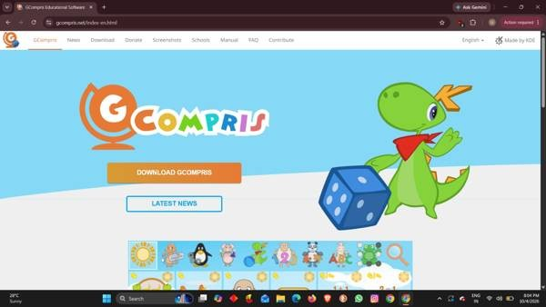
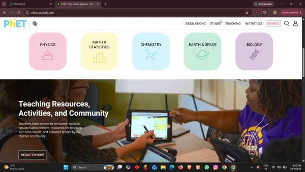
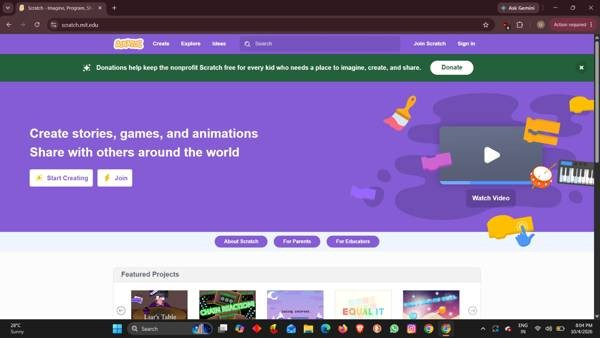
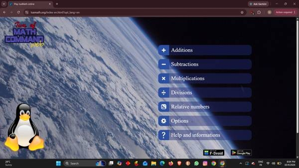
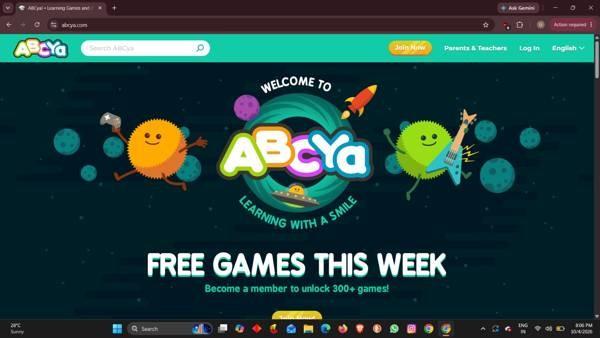
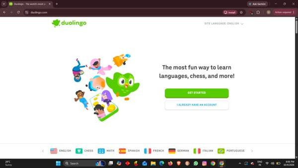
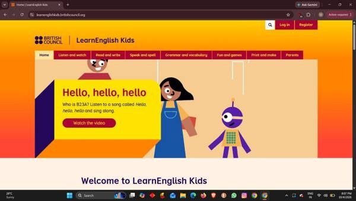
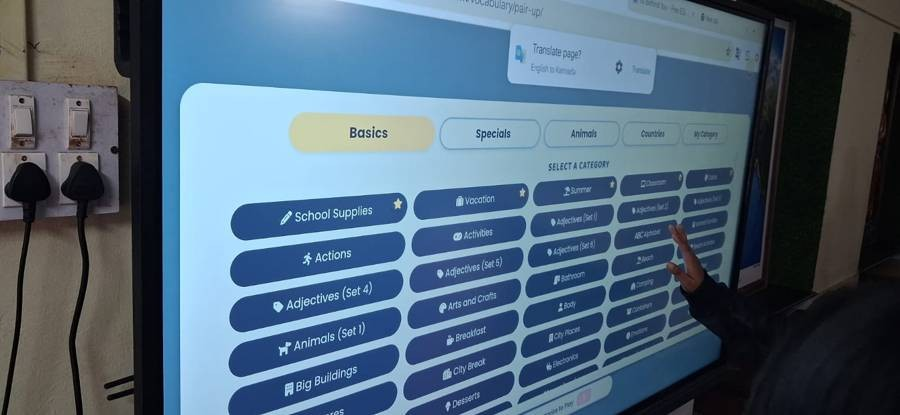
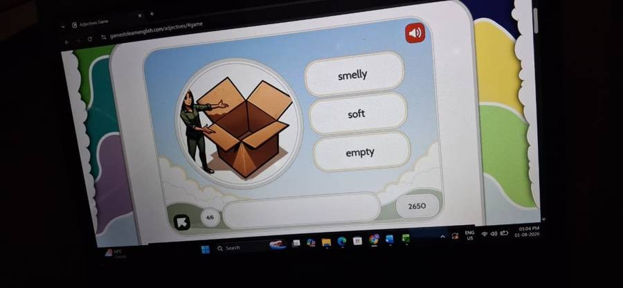
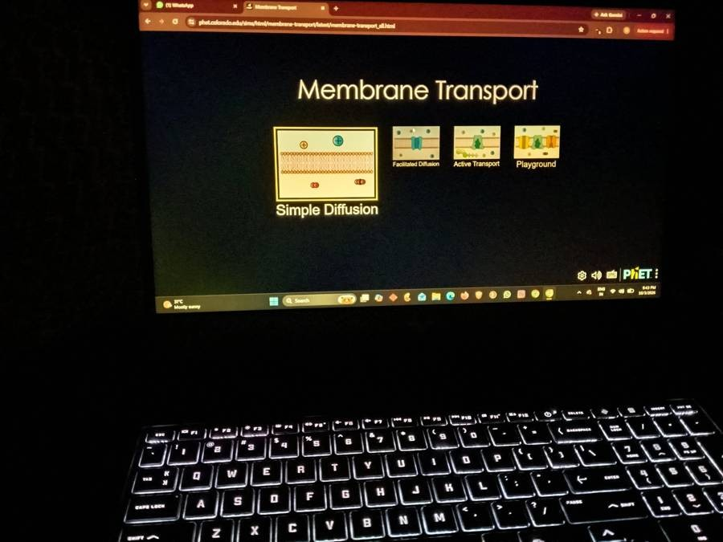

+++
contributor = "ummehabiba-kotwal"
title = "Ummehabiba Akeelahmed Kotwal - Week 3"
date = 2026-10-17
draft = false
author = "Ummehabiba Akeelahmed Kotwal"
role = "IT Manager Intern"
week = 3
emoji = "💻"
+++



## 💻 Ummehabiba Akeelahmed Kotwal

### Week 3: Evaluating Educational Software as an IT Manager

*IT Manager Intern · EdTech Research Internship, Week 3 of 7*

After the initial classroom interaction, my work moved towards testing and evaluating educational software and websites.

We explored tools such as:

- GCompris
- PhET Simulations
- Scratch
- TuxMath
- ABCya
- Duolingo
- Toy Theater
- Other educational resources identified during research

The objective was not simply to collect a list of applications.

The important question was: **Can this tool realistically be used by the students with the hardware, internet connectivity and safety requirements available to us?**

*GCompris*

*PhET Simulations*

*Scratch*

*TuxMath*

*ABCya*

*Duolingo*

*LearnEnglish Kids*

*Choosing a vocabulary category on a classroom touch display*

*An adjectives game used while testing language tools*

#### My Evaluation Approach

I started looking at educational software from several perspectives:

1. **Educational value:** Does the application actually support the intended subject or skill?
2. **Usability:** Can children understand the interface without continuous assistance?
3. **Hardware compatibility:** Can the software run on the available computers, especially lower-specification systems?
4. **Internet requirements:** Does it require a stable internet connection, or can it work offline?
5. **Advertisements and external content:** Does the platform contain advertisements, unnecessary links or content that may not be appropriate for children?
6. **Accessibility:** Can students with different levels of technical ability use it comfortably?
7. **Privacy and security:** What information does the software or website require? How should accounts, credentials and student-related information be handled?
8. **Independence:** Can students eventually use the tool with minimal assistance?

This made software evaluation much more systematic than simply asking whether an application "works."

*PhET's Membrane Transport simulation menu on a laptop*

#### Researching Kid-Safe DNS

Another area I researched was DNS-based content filtering.

DNS, or Domain Name System, translates domain names into IP addresses. Family-oriented DNS services can apply filtering policies to restrict access to categories of inappropriate or unsafe websites.

I researched options such as:

- AdGuard Family
- Cloudflare Family
- CleanBrowsing

The purpose was to understand how network-level controls could contribute to creating a safer browsing environment for children.

This was particularly interesting to me because it connected my EdTech work with cybersecurity and networking concepts.

I also learned an important distinction: DNS filtering is only one layer of protection. It should not be treated as a complete cybersecurity solution.

#### Security Considerations

We also considered basic security practices such as:

- Protecting account credentials.
- Avoiding unnecessary exposure of passwords.
- Controlling access to systems.
- Maintaining backups of important documentation.
- Checking permissions and technical requirements.
- Considering privacy when software processes user information.
- Reducing unnecessary exposure to advertisements or external content.

#### Free vs Open Source: What I Actually Learned

This evaluation also helped me understand why the internship emphasizes free and open-source solutions.

"Free" can refer to zero financial cost, while "free software" can also refer to freedoms granted by the software's license, such as the ability to study, modify or share the software under its applicable terms.

For our work, both practical affordability and long-term flexibility were relevant.

| | Free of cost | Open source |
|---|---|---|
| **Meaning** | No payment required | Source code available under a license |
| **Modification** | May still be proprietary | May allow modification and redistribution |
| **Rights** | License restrictions can remain | Depend on the specific license |

#### What I Learned

This week changed the way I evaluate software.

Earlier, I would have mainly checked: *"Does it run?"*

Now I consider: *"Does it solve the educational problem, work on the available hardware, remain usable for children, protect users, avoid unnecessary risks and remain practical to maintain?"*

That shift from software testing to technology evaluation was one of the most valuable lessons of this part of my internship.

*Written by Ummehabiba Akeelahmed Kotwal, IT Manager Intern. IT Manager internship with Pthoth in collaboration with Swami Vivekanand Seva Pratisthan (SVSP), Belagavi.*
