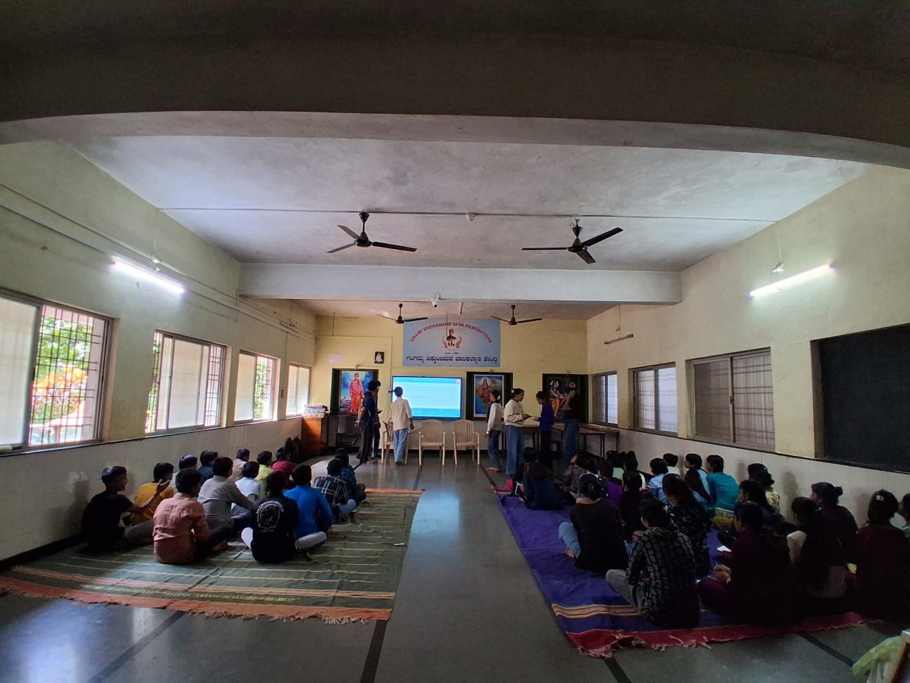
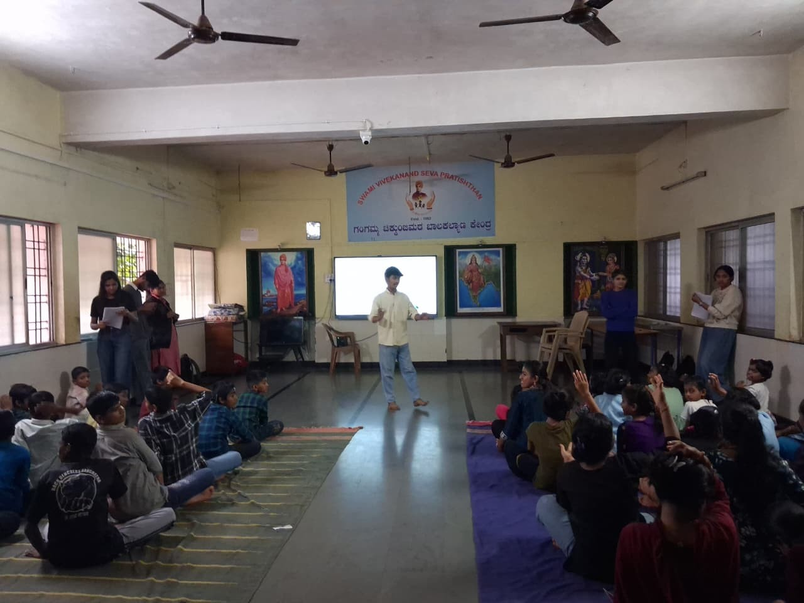
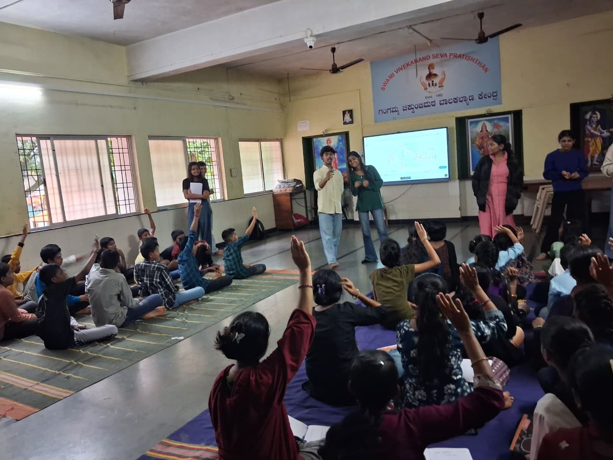

+++
contributor = "vinit-lohar"
title = "Vinit - Weeks 3 to 5"
date = 2026-10-17
draft = false
author = "Vinit Lohar"
week = 3
emoji = "🎲"
+++



## 🎲 Vinit Lohar

### Learning Through Play: Weeks 3 to 5 at Pthoth Labs

After two weeks of building trust and trying out play-based learning, our Saturday sessions entered a new phase. Weeks 3, 4 and 5 were about testing different ways of teaching and learning what actually works for our students.

#### How We Organised the Sessions

Our POCs planned how to group the students, and we settled into class bands, each with its own teacher and researcher. This gave every child more attention and made the sessions easier to observe.

*Students seated in class groups, each with its own teacher and researcher.*

#### What Teachers and Researchers Tried

Teachers tried a mix of methods and techniques, including demonstrations, simulations, games, videos, quizzes, drawing, and pair and group work. Not everything worked. Some students were distracted by noise and by what was going on around them, and some methods suited certain students better than others.

Our researchers also tried new techniques. Besides pre-tests and post-tests, they began tracking specific, observable parameters, such as whether students could predict answers, find and fix their own mistakes, help each other, and apply what they learned to a new problem. These findings help our teachers plan better sessions.

*A teacher leads a demonstration before the games begin.*

#### What We Saw

- **Students are warming up.** They became friendly with their teachers and researchers, and were more willing to ask questions and try again after mistakes.
- **Games and hands-on activities worked best.** Interactive play held attention far better than videos alone.
- **Pairing alone is not enough.** Pairs and groups worked well when we gave them structure or roles, or a task that needed two minds.
- **No single method reaches everyone.** Some students learned best from explanation, others from simulations, games, or drawing.
- **Strong results after support.** In several classes, most students could apply the concept by the end of the session, after extra explanation and practice.
- **The environment matters.** Noise from a shared room and a faulty smart board affected concentration.

*Hands go up as students answer questions.*
