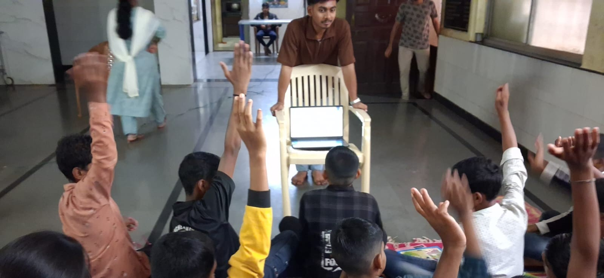

+++
contributor = "vishwas-karikatti"
title = "Vishwas Karikatti - Week 3"
date = 2026-10-17
draft = false
author = "Vishwas Karikatti"
role = "Teacher Intern"
week = 3
emoji = "👨‍🏫"
+++



## 👨‍🏫 Vishwas Karikatti

### Week 3: Building Confidence and Student Participation

*Teacher Intern · Internship Journal, Week 3*

**Branch:** Robotics and Artificial Intelligence
**College:** Maratha Mandal Engineering College
**Organisation:** Pthoth, in collaboration with Swami Vivekanand Seva Pratisthan (SVSP), Belagavi

#### Introduction

In the first week I learned what teaching involves, and in the second week I began applying it with better planning and questioning. In the third week I focused on making sessions more engaging. I felt more confident in front of the students, and I could see them taking part more willingly and with more enthusiasm.

#### Objectives for the Week

- To build on the Week 2 methods and make every session more engaging and interactive.
- To encourage more students to answer questions and share their ideas openly.
- To handle the pace of the session better so that every student can keep up.
- To keep using mentor feedback to improve my lessons.

#### Activities Undertaken

**Classroom sessions.** Sessions were held in the hall of the Kendra, with the students seated together on mats. I continued to plan my questions in advance and kept explanations short, followed by a question. This week many more students were keen to answer, and I made sure that everyone got a turn, including the quieter ones.

*Figure 1: Students raising their hands to answer during an interactive session at the SVSP Kendra.*

**Interactive participation.** I used the laptop to show visuals and activities to the group, and asked questions at each step so that the students stayed involved. Seeing so many hands go up at once was encouraging, and it showed that the students were following the lesson and enjoying it.

#### What I Learned

- Students respond best when the lesson is interactive and they are invited to take part.
- Asking a question after each short explanation keeps the whole group attentive.
- When many students want to answer, giving everyone a fair turn keeps the session positive.
- Patience and encouragement help hesitant students to speak up.
- Regular feedback from mentors helps me improve with every session.

#### Challenges and Improvements

With so many students eager to answer, giving everyone a fair chance within the time available was my main challenge. Some students were also quicker than others, so the pace needed careful handling. Going forward, I plan to rotate who answers, use group discussions, and keep a few extra questions ready so that both quick and slower learners stay engaged.

#### Resources

- [Website reference](https://share.google/0aqfop7T59uAMzGgE)

#### Key Takeaway

Week 3 showed me that student participation grows when the classroom feels welcoming and every answer is valued. My own confidence has grown along with theirs. I look forward to continuing to learn from my students and mentors in the coming weeks.
