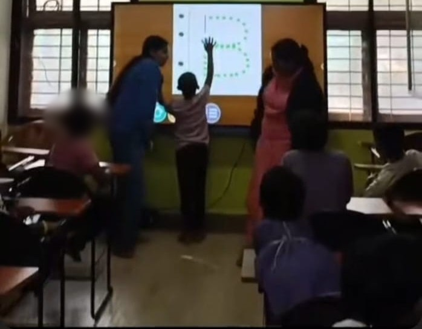

+++
contributor = "mamta-konnuri"
title = "Mamta Konnuri - Week 4"
date = 2026-10-22
draft = false
author = "Mamta Konnuri"
role = "Teacher Intern"
week = 4
emoji = "👩‍🏫"
+++



## 👩‍🏫 Mamta Konnuri

### Making Maths Feel Real

*Teacher Intern · Internship Journal | 1 August 2026*

Ask a child to add numbers on a board and you may get a blank look. Ask the same child how many pencils are left after giving two to a friend and the answer often comes right away. Same maths, very different experience.

In this week's lesson, I started teaching the Basics of Mathematics, and my goal was to make numbers feel like part of the children's everyday world rather than something that lives only in a notebook.

#### How the lesson worked

- **Explain in simple language.** I kept the words easy so the concept, not the vocabulary, was the challenge.
- **Connect to real life.** I linked each idea to examples children see every day.
- **Ask questions along the way.** Not to test them, but to check that we were still together.
- **Demonstrate with interactive tools.** I used Toy Theater and Teacher Tools to show ideas visually.
- **Practise independently.** The children tried on their own, and I re-explained wherever it was needed.

#### The power of re-teaching

This is the part I learned most from. When a child does not understand something, the first explanation has not worked, and that is not the child's failure. It is a signal for me to try a different way. Sometimes that means a new example. Sometimes it means slowing down. Either way, being ready to re-teach turns confusion into a second chance.

> **My approach this week:** Teach → Explain → Real-Life Examples → Interact → Demonstrate → Practice → Assess → Re-teach

#### Takeaway

Children learn fastest when ideas connect to things they already know. Simple language, real examples, and interactive tools can turn a plain Maths lesson into something they can see, touch, and relate to. I am starting to believe that the best teaching is less about explaining harder and more about explaining closer to the child's world.

*What is the best real-life example you have ever used to explain a tricky concept?*

#Internship #Education #Maths #InteractiveLearning #TeachingChildren #Week3
