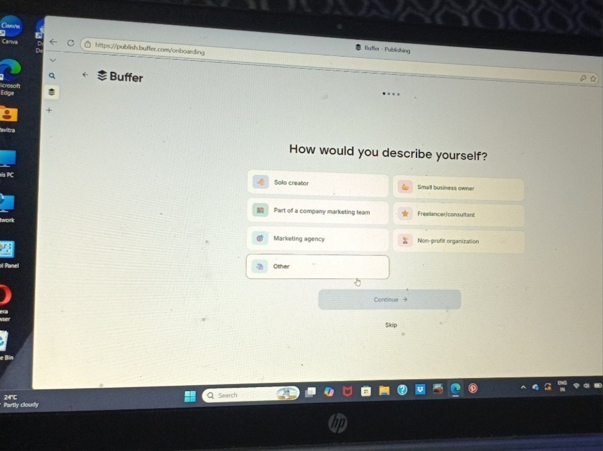

+++
contributor = "pavitra-madiwal"
title = "Pavitra Madiwal - Week 4"
date = 2026-10-22
draft = false
author = "Pavitra Madiwal"
role = "Content Creator"
week = 4
emoji = "✨"
+++



## ✨ Pavitra Madiwal

### Week 4: Social Media Strategy & Automation

*Content Creator Logbook · Week 4*

🚀 **Week 4 Pivot:** After last week's struggle with self-hosted Docker configs, I decided to pivot to Buffer, a battle-tested, ultra-clean cloud platform built specifically for content creators. No terminal errors, no server code, just straightforward post scheduling!

#### 1. The Pivot: Why Buffer Won for Content Creation

As a creator, speed and user experience are key. Buffer gives me an instant, cloud-hosted dashboard without requiring any database management or complex API credentials.

| Evaluation Parameter | Postiz (Self-Hosted Attempt) | Buffer (Chosen Solution) |
|---|---|---|
| **Setup Time** | 3+ hours (terminal / Docker issues) | 2 minutes (instant cloud onboarding) |
| **Channel Connection** | Requires custom Meta/X Developer Apps | 1-click direct OAuth authorization |
| **User Interface** | Technical admin configuration | Minimalist visual queue & calendar |
| **Reliability** | Dependent on local server uptime | 99.9% cloud uptime guarantee |

#### 2. Buffer Dashboard & Workflow Architecture

I mapped out my new streamlined publishing pipeline in Buffer to ensure a seamless workflow from drafting to automatic publishing:

1. **Canva / Studio:** Design reels & posts
2. **Buffer Queue:** Craft captions & tags
3. **Auto Scheduler:** Optimal timing rules
4. **Instagram Live:** Published automatically

#### 3. Week 4 Milestones Achieved

- ✅ **Account Setup & Onboarding:** Created our official creator profile on Buffer, configured time zones to local Indian Standard Time (IST), and set up ideal daily posting windows.
- 📅 **Content Slot Blueprint:** Established a 3-times-a-week posting slot rhythm (Monday 10 AM, Wednesday 2 PM, Friday 6 PM) tuned to target audience activity.

🎯 **Next Step Target:** With Buffer operational, Week 5 will focus on connecting our official Instagram Business page, queuing real visual assets, and recording a video proof of concept!

#### 4. Buffer Onboarding Screenshot

Screenshot of the Buffer account setup on the workstation laptop.

*Figure 4.1: Buffer account onboarding on the workstation laptop.*
