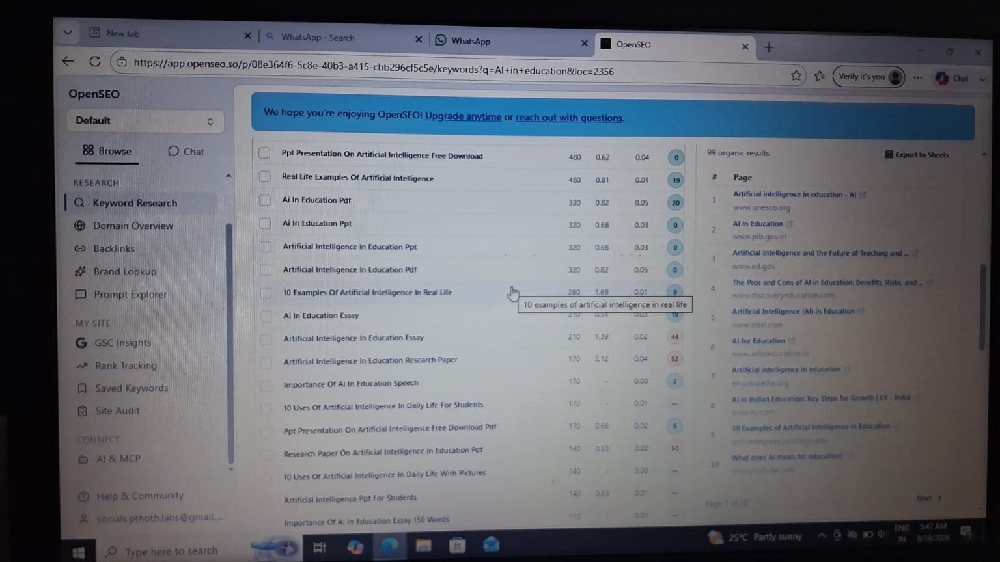

+++
title = 'Exploring Tools for Smarter Social Media Management'
date = '2026-10-23T09:00:00-07:00'
draft = false
week = 4
weight = 1
contributor = 'rakshita-pawar'
emoji = '📱'
role = 'Social Media Manager Intern'
description = 'Week 4 Social Media Manager Journal: SEO Research, Favicon Creation & Open-Source Exploration.'
+++



### Exploring Tools for Smarter Social Media Management

*Social Media Manager Journal · SEO Research, Favicon Creation & Open-Source Exploration*

During Week 4, I began exploring and using digital tools that could support PTHOTH Labs' social media and online presence. I worked with OpenSEO to explore keyword research and search-related insights, used Favicon.io to prepare favicon assets for the brand, and continued looking into other useful open-source tools and resources. This week helped me understand how research and small technical tasks can contribute to a more consistent and discoverable digital presence.

## 01 | Exploring OpenSEO

I started using OpenSEO's Keyword Research feature to explore search terms related to research and AI in education. The tool displayed information such as search volume, cost per click (CPC), competition, scores, search intent, trends, and search-result analysis. Reviewing these details helped me understand how keywords can be assessed instead of selecting them only by intuition. I explored terms connected to research, research papers, and artificial intelligence in education, which are relevant to PTHOTH Labs' education and technology context. These insights can help guide content topics and wording, although keyword metrics are indicators rather than a guarantee of social media reach.

*Figure 4.1: OpenSEO keyword research interface showing research-related search terms and metrics.*

### OpenSEO Research: AI in Education

I also explored keyword results for "AI in education." The results included related searches and phrases such as AI in education PDF, presentation, essay, research paper, and real-life examples. This helped me see that one broad topic can lead to different content needs and search intentions. Understanding these variations can support more specific ideas for educational posts, resource sharing, and future content planning.

*Figure 4.2: OpenSEO keyword results for AI in education, including related terms and search-result analysis.*

## 02 | Creating Favicon Assets with Favicon.io

I used Favicon.io to prepare favicon files for PTHOTH Labs. A favicon is a small brand icon that may appear in a browser tab, bookmark, or supported device interface. The generated package provided icon files in different sizes and formats. This task showed me that a brand needs more than a large logo for post designs; it also needs correctly sized assets for smaller digital spaces.

*Figure 4.3: Large-format icon asset from the Favicon.io package.*

## 03 | Exploring Other Open-Source Tools

Alongside OpenSEO and Favicon.io, I explored other open-source tools and online resources that could help with social media tasks and digital content work. I looked into what different tools offer and how they might support activities such as content preparation, visual design, research, and workflow organisation. This exploration was useful for identifying possible resources before deciding which ones are practical for the team's needs.

## 04 | How These Tools Support My Role

- **Keyword research:** Provides ideas for relevant topics and helps compare search terms using available metrics.
- **Brand assets:** Favicon files help represent PTHOTH Labs in small browser and device interfaces.
- **Tool exploration:** Reviewing different tools helps identify resources that may make routine tasks easier.
- **Content planning:** Research can inform topic selection and wording while keeping content aligned with the organisation's educational purpose.

## 05 | Learning & Outcome

Week 4 gave me practical experience with the research and technical side of social media management. Using OpenSEO helped me explore keyword data for research and AI in education, while Favicon.io helped me prepare a small but important brand asset. Exploring other tools also encouraged me to evaluate digital resources according to their usefulness. Together, these activities supported my understanding of how content research, brand consistency, and an organised workflow contribute to PTHOTH Labs' online presence.

## 06 | Next Steps

- Continue exploring keywords that are relevant to PTHOTH Labs' education and technology content.
- Review the generated favicon files and ensure the appropriate assets are used on the website.
- Keep a simple list of useful tools and the tasks they support.
- Apply the most relevant findings to future website and social media work.

## Week 4 Reflection

Social media management also involves research and technical preparation behind the scenes. This week, I began using tools that can support keyword discovery and brand assets, while continuing to explore other resources that may help me work more effectively. It was a step toward making PTHOTH Labs' digital presence more thoughtful, consistent, and well organised.