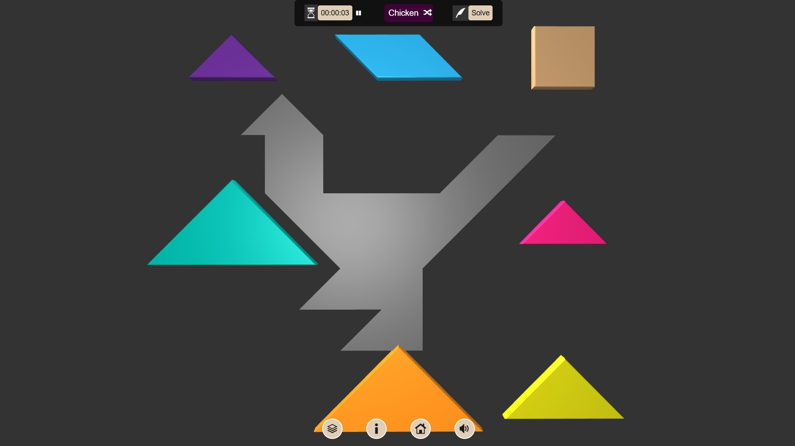
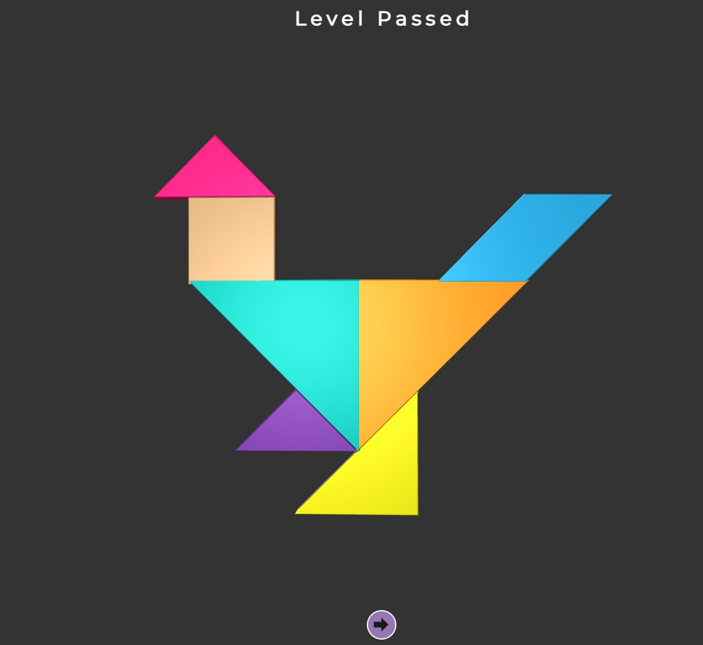
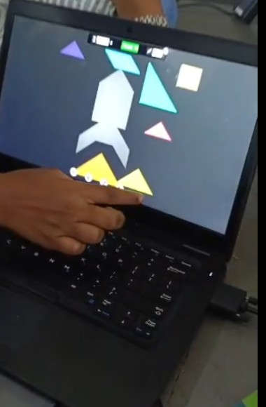

+++
contributor = "sneha"
title = "Sneha Gurav - Week 4"
date = 2026-10-22
draft = false
author = "Sneha Gurav"
role = "Researcher & Documentation Intern"
week = 4
emoji = "🧩"
+++



## 🧩 Sneha Gurav

### Seven Shapes, One Engaged Classroom

*Researcher & Documentation Intern · Research & Documentation, Week 4*

*What a digital Tangram activity revealed about student engagement and the possibilities of hands-on learning.*

**By Sneha Gurav**, Robotics and AI student, documentation intern at Pthoth × SVSP

#### 01 · The Question Behind a Puzzle

Seven geometric pieces can create far more than a completed picture. They can offer students a way to explore shapes, visualise relationships and engage with a problem through experimentation. During the Tangram activity with students from Grades 7 and 8, I observed something especially encouraging: every participating student showed interest in the activity.

In this activity the puzzle was digital. Students worked with seven pieces on a laptop screen, arranging them to fill a figure outline.

I was there as a researcher and documentation intern at Pthoth × SVSP, Belagavi, and I wanted to understand how students respond to hands-on, visual problem-solving.

#### 02 · What Tangrams Make Possible

A Tangram asks a student to turn a picture into an arrangement. To fit the pieces into a figure, a student has to look at the shape as a whole and also at the parts that could form it. That kind of looking is closely tied to visual reasoning and spatial awareness.

*Figure 1. The digital Tangram screen, showing separate pieces and a figure outline to fill.*

*Figure 2. A completed Tangram figure, displayed with the words "Level Passed."*

The puzzle also invites trial. Pieces can be turned, moved and swapped, and an arrangement that does not fit can be changed. Experimentation, shape recognition and persistence all have room to develop in this process, and a student who finds one arrangement may start to wonder how the same shapes could form another.

These are opportunities the activity offers. Whether and how each student used them is something my observations do not show. The screenshots above show the interface and one completed figure; they do not show how many students completed a level.

#### 03 · What the Students Showed

The clearest observation I can report is also the simplest. Every participating student showed interest in the Tangram activity, and the students were completely involved in it.

*Figure 3. Interacting with the digital Tangram activity on a laptop.*

Complete involvement across a group is a result worth recording, and I have recorded it as I observed it. I did not record specific actions, statements or timings, so I will not describe any. What I can describe is the pattern: no participating student stood apart from the activity.

For an educational researcher, this matters because involvement is where learning has to begin. A task that students are not drawn into has little chance to teach anything.

#### 04 · What Engagement Can Tell Us

Complete involvement suggests that a hands-on, visual task can draw a group of Grade 7 and 8 students in. That is a promising sign for this kind of learning, and I want this article to say so without hedging it away.

What engagement cannot tell me, by itself, is what each student understood, remembered or became better at. Interest and involvement describe how students approached the task. Understanding, retention and skill development are different things, and each would need its own evidence.

That does not weaken the observation. It only marks what each kind of evidence can carry. Measuring understanding would be an addition to the result, not a correction of it.

So I read it as a strong starting point: a well-supported reason to look more closely at what happens inside an activity that students are fully involved in.

#### 05 · What I Would Examine Next

If the Tangram activity is repeated, I would like to look beyond visible interest at how students work through the puzzle. The indicators below are proposals for future sessions, with a working definition for each. None of them were measured in the activity described in this article.

**Table 1. Proposed Observation Framework for Future Tangram Sessions**

| Observation Indicator | What It Could Reveal |
|---|---|
| **Task engagement:** whether a student stays actively working on the puzzle | How involvement is sustained across the activity |
| **Shape-arrangement attempts:** each separate placement a student tries | How students explore possible arrangements |
| **Strategy changes during problem-solving:** a recorded change in the approach used to arrange the pieces | Whether students adjust their approach when an arrangement does not fit |
| **Independent completion:** a figure completed without help from another person | Which figures students can complete without assistance |
| **Explanations of shape placement:** a student's verbal or written reason for placing a piece | Whether students can say why a piece goes where it does |

Together, these would describe the learning process and not only the interest around it. Attempts and strategy changes could show persistence and experimentation in action, while explanations of shape placement could show whether students can put their spatial reasoning into words. Independent completion would help separate what students can do alone from what they do with support.

I would record these as observations first and interpret them afterwards, and I would not attach numbers to them unless they were actually counted.

#### 06 · Learning to Record Good News

Observation is not only a way of finding problems. I had been practising how to question, qualify and look for gaps, so it was a useful change to meet an observation that was simply and fully positive. Documenting it accurately took the same care as documenting any difficulty.

As a documentation intern, I am learning that accuracy works in both directions. I should not inflate a positive result into proof of learning, and I should not shrink it because it has no numbers attached.

I do not yet know how much each student learned from the Tangram activity. What I can confidently record is that every participating student showed interest and involvement. For my research, that is not the end of the question. It is a meaningful starting point for understanding how engagement can lead to learning.

---

*Pthoth × Swami Vivekanand Seva Pratisthan (SVSP), Belagavi · Internship Experience · Research & Documentation*

*Sneha Gurav · Researcher & Documentation Intern*
