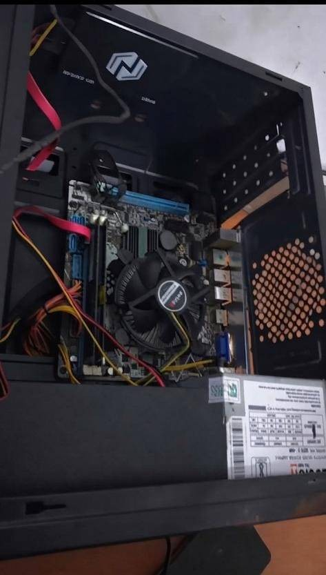
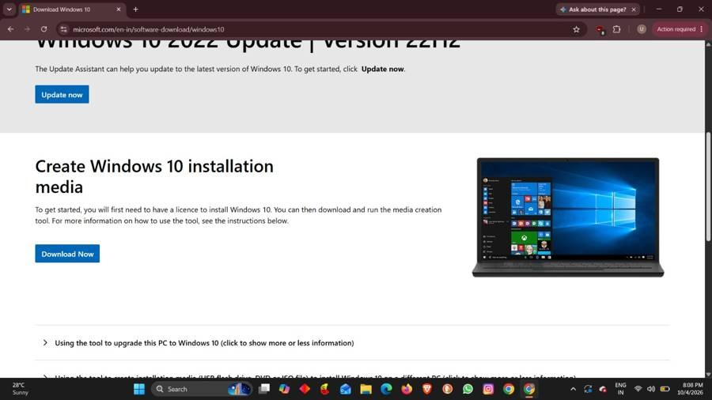
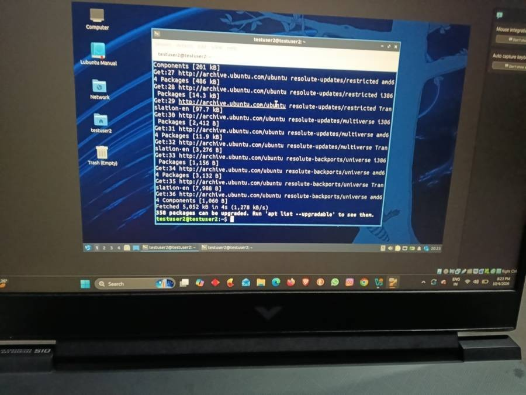
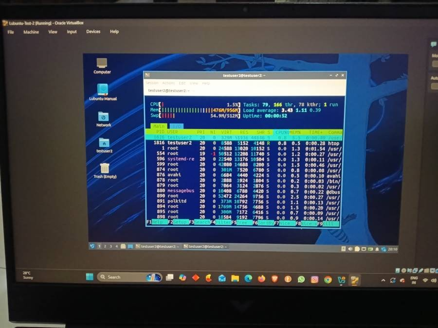

+++
contributor = "ummehabiba-kotwal"
title = "Ummehabiba Akeelahmed Kotwal - Week 4"
date = 2026-10-22
draft = false
author = "Ummehabiba Akeelahmed Kotwal"
role = "IT Manager Intern"
week = 4
emoji = "💻"
+++



## 💻 Ummehabiba Akeelahmed Kotwal

### Week 4: Windows, Linux and Giving Low-Spec Computers a New Purpose

*IT Manager Intern · EdTech Research Internship, Week 4 of 7*

One of the more technical parts of my internship involved researching how older computers could be made useful again for educational purposes.

The target systems included low-specification machines, with research focused on hardware around 1 GB RAM, older Intel Pentium-class processors and approximately 120 GB storage.

Instead of assuming that old hardware was unusable, we investigated whether lightweight operating systems and careful configuration could make these computers practical for basic educational activities.

*Inside an older desktop PC*

#### Windows 10 Configuration

I also worked with Windows 10 installation and configuration.

One of the things I tested was an XML-based unattended installation/configuration approach. The purpose was to reduce repetitive manual configuration and make the setup process more consistent.

*Microsoft's Windows 10 installation media page*

I also worked on making educational tools easier for students to access by configuring shortcut keys and easier access methods.

This showed me that deployment is not only about installing an operating system.

A usable educational computer also needs to be configured according to the users' needs.

#### Exploring Lubuntu

For very low-specification systems, I researched lightweight Linux distributions.

Lubuntu became an important candidate because of its lightweight desktop environment and suitability for older hardware.

I tested Lubuntu in a virtual machine configured with approximately:

- 1 GB RAM
- 1 CPU core
- 30 GB virtual disk

The purpose was to see whether the environment remained usable under constrained resources before considering deployment on physical computers.

*The Lubuntu desktop running in a VirtualBox virtual machine, with a terminal open*

#### What I Tested

I used basic system-monitoring and diagnostic commands to understand resource usage.

I also tested:

- System information scripts.
- CPU and memory information.
- Disk information.
- Firefox installation and operation.
- htop for resource monitoring.
- GCompris.
- Custom keyboard shortcuts.
- LXQt configuration.
- Automatic startup applications.
- Shell scripts for configuration.

The tests showed that the lightweight Linux environment could operate within the constrained VM, although applications such as GCompris could take longer to start.

*htop in the Lubuntu test VM: about 476 MB of 956 MB memory in use and CPU at 1.5%*

#### What I Learned

This work taught me that hardware requirements written on a software website are only a starting point.

Real-world performance depends on the combination of: **operating system + hardware + application + configuration + workload.**

I also became more comfortable with Linux commands, shell scripts, system monitoring and troubleshooting.

Most importantly, I learned to test an environment before deploying it rather than assuming that a theoretically suitable configuration will automatically work in practice.

*Written by Ummehabiba Akeelahmed Kotwal, IT Manager Intern. IT Manager internship with Pthoth in collaboration with Swami Vivekanand Seva Pratisthan (SVSP), Belagavi.*
