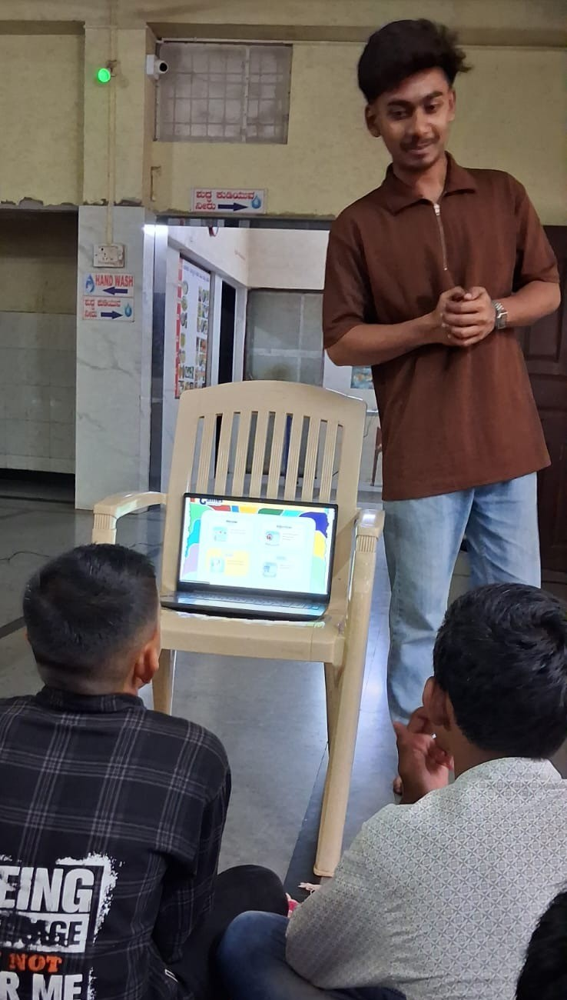

+++
contributor = "vishwas-karikatti"
title = "Vishwas Karikatti - Week 4"
date = 2026-10-22
draft = false
author = "Vishwas Karikatti"
role = "Teacher Intern"
week = 4
emoji = "👨‍🏫"
+++



## 👨‍🏫 Vishwas Karikatti

### Week 4: Learning Through Quizzes and Digital Activities

*Teacher Intern · Internship Journal, Week 4*

**Branch:** Robotics and Artificial Intelligence
**College:** Maratha Mandal Engineering College
**Organisation:** Pthoth, in collaboration with Swami Vivekanand Seva Pratisthan (SVSP), Belagavi

#### Introduction

In the first week I learned what teaching involves, in the second week I began applying it with better planning and questioning, and in the third week I focused on building confidence and encouraging student participation. In the fourth week I wanted to make learning more fun and to check how well the students had understood. I used quiz-based activities on the laptop, and I saw the students enjoy answering and think carefully about their choices.

#### Objectives for the Week

- To use quizzes and digital activities to make sessions more enjoyable and interactive.
- To check what the students have understood through short, simple questions.
- To keep every student involved, including the quieter ones, while the quiz is going on.
- To keep using mentor feedback to improve my lessons.

#### Activities Undertaken

**Classroom sessions.** Sessions were held in the hall of the Kendra, with the students seated together on mats. I continued to plan my questions in advance and kept explanations short. This week I added quiz-style questions at the end of each topic so that the students could recall what they had learned and apply it.

**Quiz activity.** I placed the laptop in front of the group and presented the quiz questions one by one. The students looked at the screen, discussed the options among themselves, and then answered. After each question I explained the correct answer in simple words so that everyone could follow.

*Figure 1: Presenting a quiz activity on the laptop to the students at the SVSP Kendra.*

*Figure 2: The National Geographic Kids quizzes page used as the reference.*

**Using an online resource.** I used the quizzes section of National Geographic Kids (Figure 2) as a reference for the activity. Its colourful, question-based format caught the students' attention, and it showed me how a simple quiz can turn revision into a game.

#### What I Learned

- Quizzes make students curious and keep them attentive for longer.
- Short questions after each topic help me understand quickly what the students have grasped.
- Explaining the correct answer after every question turns mistakes into learning.
- Visuals and colourful content help the students stay interested and remember better.
- Regular feedback from mentors helps me improve with every session.

#### Challenges and Improvements

Since the whole group was watching one laptop screen, it was difficult to make sure that every student could see clearly and take part equally. A few students answered very quickly, while others needed more time to think. Going forward, I plan to divide the students into small teams, give everyone time to discuss before answering, and prepare a few extra questions so that both quick and slower learners stay engaged.

#### Resources

- [Website reference: National Geographic Kids – Quizzes](https://share.google/Dg6BF6cm7AzhFfjfU)

#### Key Takeaway

Week 4 showed me that learning becomes more effective when it feels like play. Quizzes helped the students stay curious and helped me see their understanding clearly. My own confidence and teaching skills continue to grow with every session, and I look forward to learning more from my students and mentors in the coming weeks.
