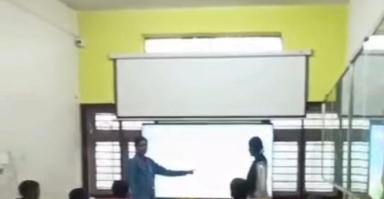

+++
contributor = "mamta-konnuri"
title = "Mamta Konnuri - Week 5"
date = 2026-10-23
draft = false
author = "Mamta Konnuri"
role = "Teacher Intern"
week = 5
emoji = "👩‍🏫"
+++



## 👩‍🏫 Mamta Konnuri

### From Repeated Addition to Building My Own Learning Website

*Teacher Intern · Internship Journal | 15 August 2026*

Multiplication tables are often learned the hard way: repeat them again and again until they stick. In week 5, I wanted to try something different.

#### Teaching tables differently

This week I taught **Mathematical Tables**, but instead of asking children to memorise them, I framed multiplication as **repeated addition** and focused on **number patterns**. When a child sees that 3 times 4 is just 3 added four times, the table stops being a list to remember and becomes an idea to understand. Patterns also make tables easier to recall, because there is a logic behind the numbers.

#### And then I built something

Alongside the lesson, I built my own interactive educational website, **Fun Maths Learning**, for students from 1st to 5th standard. I wanted a tool that supports the way I teach, where the children are taught, shown, and then given a chance to practise by playing.

The website has four activities:

- **Equal Groups:** understand multiplication by seeing items grouped equally.
- **Fair Sharing:** connect maths to everyday situations like sharing.
- **Multiplication Race:** practise with a little fun and friendly speed.
- **Missing Number:** build problem-solving by finding what is missing.

Each activity comes in three levels: **Easy, Medium and Challenge**. That was important to me. After week 1, I knew the children in a class are at very different stages, and a tool that only works at one level works for very few of them.

My approach this week: Teach > Explain the Concept > Repeated Addition and Patterns > Demonstrate > Involve > Interactive Practice > Independent Solving > Assess > Re-teach

#### Takeaway

This week connected everything I had been learning in the classroom with the research goal behind the internship. Building Fun Maths Learning made me realise that gamified learning is not about adding games on top of lessons. It is about designing practice so that children want to come back to it.

It was a challenging week, but easily one of the most rewarding so far.

*What is one tool or resource you built yourself that made a real difference to the people you were helping?*

#Internship #Education #Maths #EdTech #GamifiedLearning #FunMathsLearning #Week5
