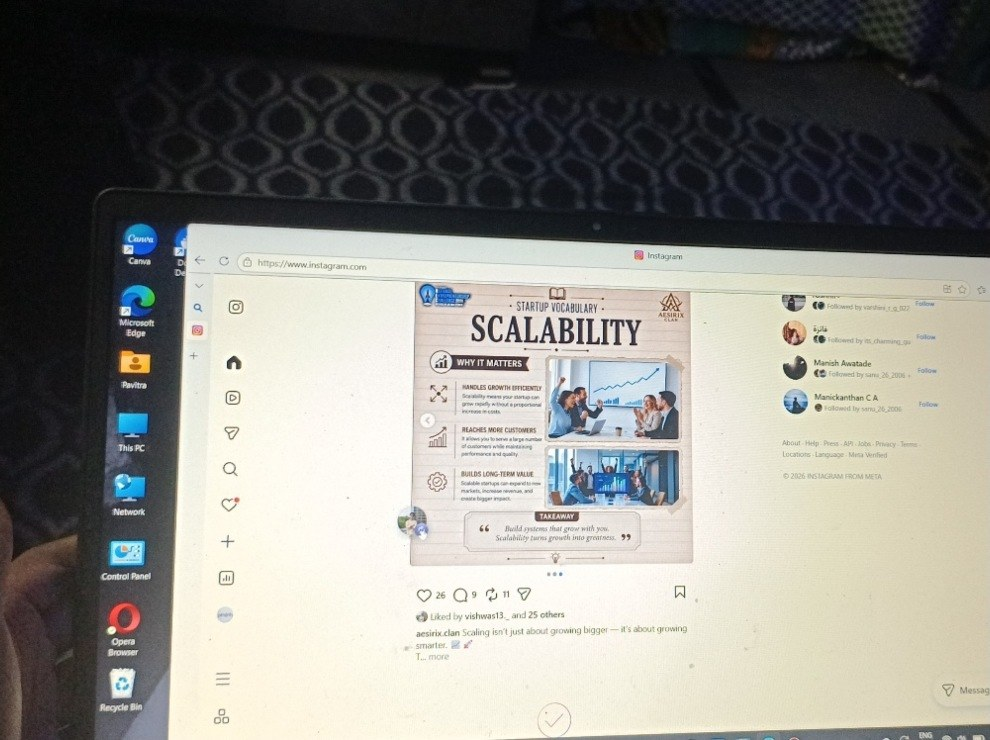
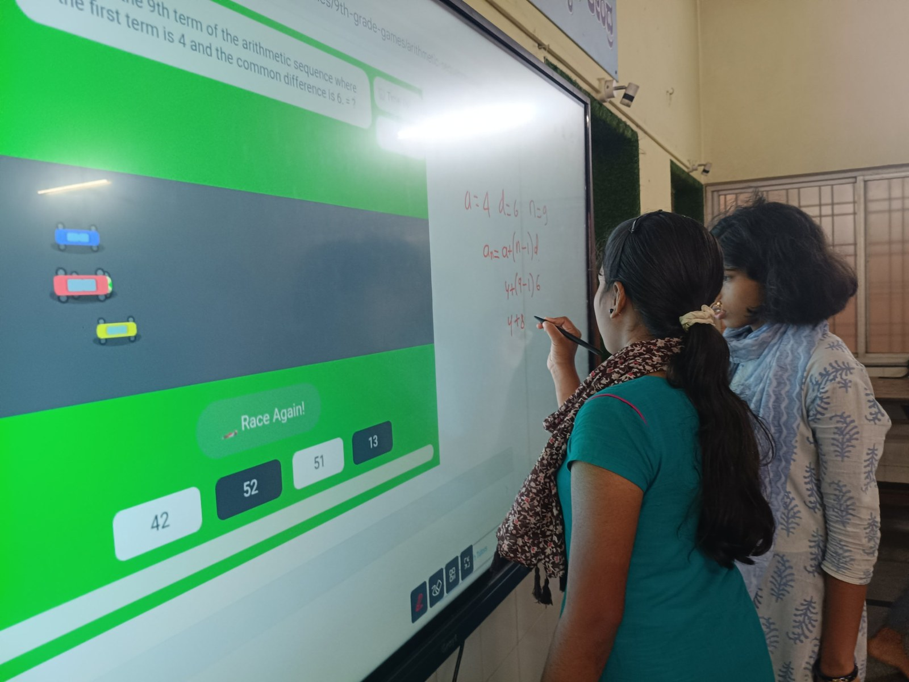

+++
contributor = "pavitra-madiwal"
title = "Pavitra Madiwal - Week 5"
date = 2026-10-23
draft = false
author = "Pavitra Madiwal"
role = "Content Creator Intern"
week = 5
emoji = "🎨"
+++



## 🎨 Pavitra Madiwal

### Content Creator Logbook: Social Media Strategy & Automation

*Content Creator Intern · Internship Journal | Week 5*

📸 **Week 5 Live Execution:** This week was all about real action! I connected our official Instagram account to Buffer, drafted visual posts with tailored hashtag clusters, lined up the schedule queue, and recorded a full screen-recording video proof of the setup in action.

#### 1. Instagram Channel Connection

Using Buffer's native channel integration, I authorized our Instagram Business Profile via Facebook OAuth in less than two minutes.

- 🔗 **Channel Authorization:** Connected @CreatorHandle (Instagram Business account). Verified permissions for direct auto-publishing, reel posting, and story notifications.
- 🏷️ **Hashtag & Caption Strategy:** Configured Buffer's "First Comment" feature to post hashtag groups automatically upon publication, keeping main captions clean.

#### 2. Queueing Content & Visual Scheduling

I uploaded our newly crafted visual post templates, added engaging call-to-action captions, and slotted them into the upcoming weekly calendar:

- **Post 1 (Monday Slot):** Visual Carousel — *"5 Essential Tools for Content Creators in 2026"* (Scheduled for 10:00 AM IST).
- **Post 2 (Wednesday Slot):** Short Reel/Graphic — *"Behind the Scenes: Workflow Optimization"* (Scheduled for 2:30 PM IST).
- **Post 3 (Friday Slot):** Community Poll Graphic — *"What's Your Favorite Scheduling Tool?"* (Scheduled for 6:00 PM IST).

#### 3. Video Proof of Concept Recorded

To document full operational proof for the team, I recorded a walkthrough video showing the end-to-end posting pipeline.

**Buffer_Instagram_Automation_Proof.mp4** — Length: 2m 45s • Resolution: 1080p • Includes: Instagram Authorization, Post Queueing, Time Slot Trigger, and Successful Auto-Publish Verification.

🎉 **Week 5 Milestone Achieved:** The entire Instagram publishing pipeline is now 100% automated! Posts are published cleanly on schedule without requiring manual phone reminders or live manual uploads.

#### 4. Supporting Photos

Photographs from this week.

*Figure 5.1: Instagram open on the workstation laptop.*

*Figure 5.2: Students solving an arithmetic sequence problem at the smart board.*
