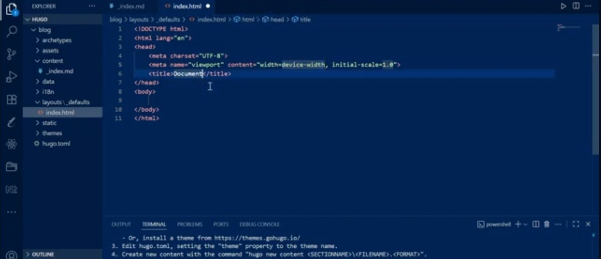
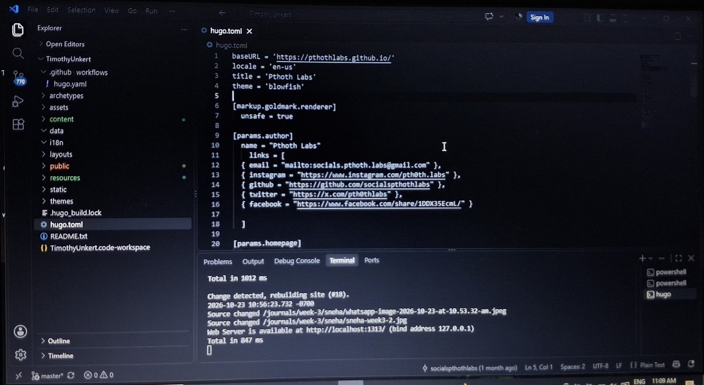

+++
contributor = "rakshita-pawar"
title = "Rakshita Pawar - Week 5"
date = 2026-10-23
draft = false
author = "Rakshita Pawar"
role = "Social Media Manager Intern"
week = 5
emoji = "📱"
+++



## 📱 Rakshita Pawar

### Learning Hugo While Keeping the Content Going

*Social Media Manager Intern · Internship Journal | Week 5*

During Week 5, I started building with Hugo for the PTHOTH Labs website while continuing my regular social media work. I worked on the Hugo installation, followed a tutorial on YouTube, and took guidelines from my seniors. At the same time, I kept posting content regularly, including reels and posts, on Instagram, Facebook and other platforms. This week showed me how technical learning and everyday content work can happen side by side.

#### 01 | Getting Started with Hugo

Hugo is a static site generator, and it is the tool the PTHOTH Labs website is built with. My first task was the installation: getting Hugo working on my computer and opening the project in VS Code. Since Hugo was new to me, I did not want to guess my way through it, so I started with a tutorial video on YouTube.

The tutorial walked through creating a new Hugo project, adding a layout file and running the project. The terminal in the video also lists the usual next steps after a site is created: choose a theme, set it in `hugo.toml` and create new content.

*Figure 5.1: A YouTube tutorial on Hugo, showing a new project in VS Code with an index.html layout file and the next steps in the terminal.*

#### 02 | Learning from the Tutorial and from Seniors

Watching the tutorial helped me recognise the main parts of a Hugo project, such as the **content**, **layouts**, **themes** and **static** folders and the `hugo.toml` configuration file. Seeing how these pieces fit together made the PTHOTH Labs project much easier to open and understand.

I also received guidelines from my seniors. Their guidance helped me approach the work step by step and understand how my tasks connect to the website. Learning from a tutorial and from people who already know the project turned out to be a useful combination.

#### 03 | Exploring the Site Configuration

I explored the project's `hugo.toml` file. It holds the site's base URL, title and theme (Blowfish), along with the author details and the social links shown on the website: email, Instagram, GitHub, X and Facebook. For a social media manager, this was a useful discovery, because it showed me where the website points to the organisation's social accounts.

Running `hugo server` showed the website on a local address in the browser. The terminal reported each time a file changed and rebuilt the site, so I could see my changes take effect as I worked.

*Figure 5.2: The PTHOTH Labs project in VS Code, showing the hugo.toml configuration file and the local Hugo server running in the terminal.*

#### 04 | Posting Regularly on Social Media

Alongside the Hugo learning, I continued my main responsibility: posting content regularly. This week I shared reels and posts on Instagram, Facebook and other platforms. Posting consistently while learning a new technical skill taught me to plan my time, so that neither the learning nor the content was left behind.

#### 05 | How This Work Supports My Role

- **Hugo learning:** Helps me understand how the PTHOTH Labs website is built and maintained.
- **Site configuration:** Shows where the website links to our social media accounts.
- **Regular posting:** Keeps the PTHOTH Labs audience engaged with reels and posts.
- **Guidance from seniors:** Gives direction and helps me improve step by step.

#### 06 | Learning & Outcome

Week 5 gave me my first practical experience with Hugo. I worked on the installation, learned the basics from a YouTube tutorial and explored the project with guidance from my seniors. At the same time, I stayed consistent with my posting on Instagram and Facebook. Together, these activities helped me see that social media management and website work support each other.

#### 07 | Next Steps

- Continue learning Hugo and become comfortable working in the project.
- Keep posting reels and posts regularly across our social media platforms.
- Make sure the social links on the website match our active accounts.
- Keep asking my seniors for guidance and apply their feedback.

#### Week 5 Reflection

This week I learned that being a social media manager can also mean learning the technical side of a team's online presence. Starting with Hugo was a new challenge, but the tutorial and my seniors' guidelines made it manageable, and I kept my content going while I learned.
