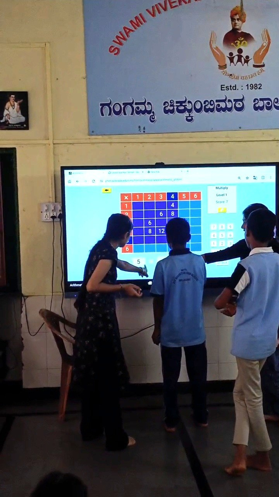
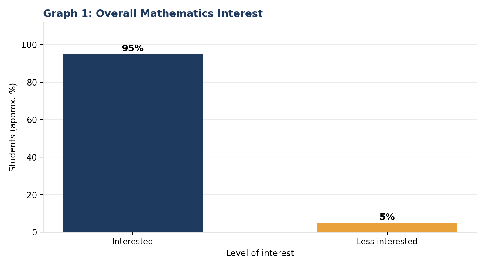
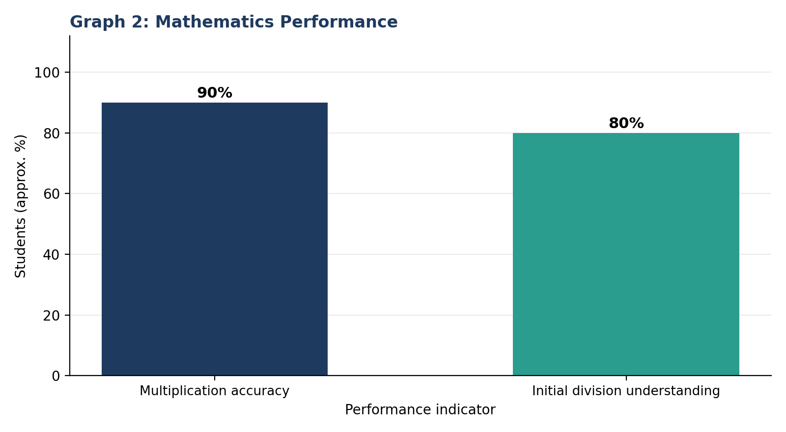
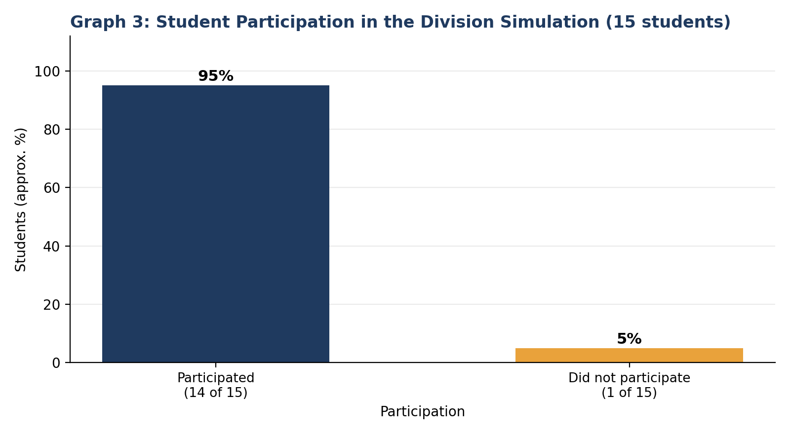
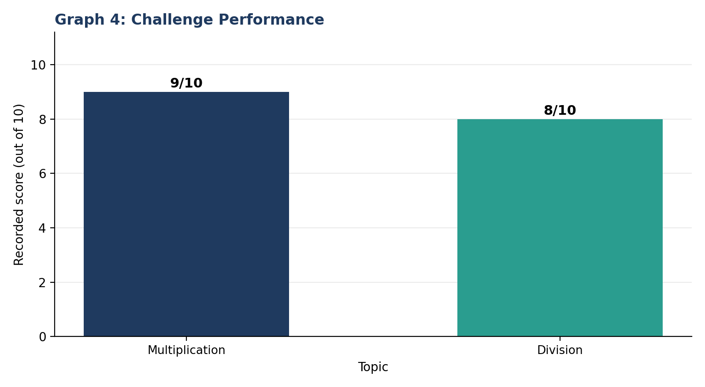
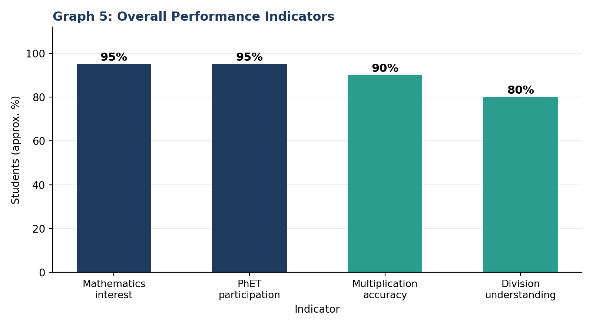

+++
contributor = "shreya"
title = "Shreya Hebbalkar - Week 5"
date = 2026-10-23
draft = false
author = "Shreya Hebbalkar"
role = "Researcher and Documentation Intern"
week = 5
emoji = "🔬"
+++



## 🔬 Shreya Hebbalkar

### Seeing Beyond the Answer: A Researcher's Journey in Observing Mathematics Learning with PhET Simulations

*Researcher and Documentation Intern · Internship Journal | Week 5*

#### 1. Title and Researcher Details

| | |
|---|---|
| **Researcher** | Shreya Hebbalkar |
| **Role** | Researcher and Documentation Intern |
| **College** | Maratha Mandal Engineering College, Belagavi |
| **Organisation** | Pthoth, in collaboration with Swami Vivekanand Seva Pratisthan (SVSP), Belagavi |
| **Research area** | Mathematics Education and Digital Learning Tools |
| **Software** | PhET Interactive Simulations |
| **Module** | Arithmetic |
| **Topics** | Multiplication, Factors and Division |

#### 2. Abstract: An Overview of the Research

This article documents my research on how students respond to arithmetic activities carried out with PhET Interactive Simulations (Arithmetic module) on multiplication, factors and division. The purpose was to observe student interest, participation, problem-solving and the ability to explain reasoning. The research involved 15 students. Two methodologies were recorded: Think–Predict–Check and Challenge-and-Explain. I documented observations, approximate percentages, scores out of 10 and performance grades.

Approximately 95% of students showed interest in mathematics, and 14 of 15 students (approximately 95%) participated in the division simulation. Approximately 90% solved multiplication problems correctly and explained their reasoning, while approximately 80% already understood division. In the challenge activity, multiplication was recorded at 9/10 and division at 8/10. The main insights are that interest and participation were high, that division needed more explanation than multiplication, and that observing reasoning gives information that correct answers alone do not. These findings come from one small observation group and are not generalised.

#### 3. Introduction: Beginning My Research Journey

Mathematics is often judged by whether an answer is right or wrong. As a Researcher and Documentation Intern, I wanted to look at the process behind the answer: how students approach a problem, whether they show interest, whether they take part, and whether they can explain why their method works. Digital simulations offer a way to make arithmetic visible and interactive, which makes them a useful setting for this kind of observation.

My role in this study was to observe the activities and record what I saw, together with approximate percentages and performance grades. I treated observation as a skill in its own right: noting interest, participation, problem-solving and reasoning separately, and being careful about what each can and cannot show.

#### 4. Purpose of the Study

The study was conducted to understand how students responded to mathematics when theoretical explanation and PhET-based interaction were used together. It aimed to investigate the following:

- Student interest in mathematics.
- Participation in PhET-based activities.
- Performance in multiplication, division and factors.
- Responses to problems of increasing difficulty.
- Students' ability to explain their mathematical reasoning.
- Difficulties students faced and their responses to additional explanations.

#### 5. Understanding the Learning Environment

The research involved 15 students and focused on arithmetic activities using the Arithmetic module of PhET Interactive Simulations, covering multiplication, factors and division. Students worked with both theoretical methods and the simulations. The source report does not give the date, duration, school, classroom details or student demographics, so none are stated here. The only participant detail the report records is that one student, from Grade 10, took part less in the division activity.

#### 6. My Research Approach

My approach was direct observation. I watched how students attempted problems, how they used the simulation, and how they described their methods, and I recorded the results as approximate percentages, counts, scores out of 10 and grades. The report does not describe a separate formal test, so I do not claim one. The figures are my documented observations of the activity.

**A. Think–Predict–Check**

Students were presented with mathematical problems and encouraged to predict and solve them. They then used the PhET simulation to check their understanding, and they were asked to explain their reasoning. This sequence let me see not only the answers but also how students tested and justified them.

**B. Challenge-and-Explain**

Students were given problems of increasing difficulty and asked to describe the methods they used. This allowed me to see how performance changed as problems became harder, and whether students could still explain their approach.

**How I documented the observations**

For each topic I recorded the approximate share of students who showed interest, solved problems correctly or took part, the count of students where it was known (2 of 15 and 14 of 15), and a grade out of 10 for interest, Think–Predict–Check, participation, problem-solving accuracy and explanation quality.

#### 7. Exploring PhET Through Arithmetic Activities

PhET Interactive Simulations provided the interactive environment for the activities. In this study the Arithmetic module was used alongside theoretical explanation, so that students could attempt a problem, check it in the simulation and then explain it. My focus was on what students did and how they responded, not on describing the software.

**7.1 Multiplication**

During my observation, approximately 90% of students solved the multiplication problems correctly and could explain their reasoning. About 10%, which was 2 of 15 students, initially struggled because of limited prior knowledge. After interacting with the simulation, these students were able to answer and take part in the activity. When the difficulty was increased, students continued to solve multiplication problems successfully, and the challenge performance was recorded at 9/10.

*Students interacting with the Arithmetic simulation (multiplication) on the classroom display during the session.*

**7.2 Division**

In division, approximately 80% of students already knew the concept, while about 20% needed additional explanation. Different ways of solving division, including theoretical and traditional methods, were explained, after which students could solve simple problems. As the level increased, I recorded more difficulty. The methods taught earlier helped students approach the problems both theoretically and through the simulation. The challenge performance for division was recorded at 8/10.

**7.3 Factors**

The concept of factors was first explained theoretically and then supported through interaction with the simulation. Students were able to solve the related problems and work with the concept after the explanation and the interaction.

#### 8. Classroom Observations and Researcher Experiences

**Interest and willingness to engage.** The first thing I recorded was a high level of interest: approximately 95% of students showed interest in mathematics, and about 5% showed less. Students were willing to solve problems by theoretical methods and also to interact with the simulations. This is my direct observation, and the interest grade I recorded was 9.5/10.

**Initial difficulties.** I noticed that not every student began with the same footing. Two of the 15 students initially faced difficulty in multiplication because they lacked prior knowledge. After using the simulation, they were able to answer and take part. I interpret this as a positive sign for the support the simulation offered, but I cannot say that the simulation alone caused it.

**Multiplication compared with division.** I recorded stronger performance in multiplication than in division. Multiplication stayed strong as problems became harder, while division problems were manageable at a simple level but created more difficulty as the level increased. The report suggests the difference may be related to how much practice students had with each concept. I treat this as a possible explanation, not an established one.

**Additional explanation and practice.** About 20% of students needed additional explanation in division. Once different methods were explained, they could solve simple problems. This showed me that explanation after an initial attempt can matter, and that practice is likely to be important for the harder problems.

**Participation and reasoning.** During the division simulation, 14 of 15 students participated. Observing how students explained their reasoning gave me information that the answers alone would not. I recorded explanation quality at 9/10, and I found this the most valuable part of the observation, because it showed whether students understood the method and did not only reach the answer.

#### 9. Data Analysis and Graphical Representation

This section presents the values exactly as recorded in the report. All percentages are approximate, and the study involved 15 students. No before-and-after comparison is made, because the report does not provide one.

**9.1 Overall mathematics interest**

*Graph 1. Approximately 95% of students showed interest in mathematics and about 5% showed less interest.*

Graph 1 indicates that interest in mathematics was high in this group.

**9.2 Mathematics performance**

*Graph 2. Multiplication accuracy was approximately 90%; initial division understanding was approximately 80%.*

Graph 2 indicates that multiplication performance was higher than initial division understanding.

**9.3 Student participation**

*Graph 3. 14 of 15 students (approximately 95%) participated in the division simulation; 1 of 15 (approximately 5%) did not.*

Graph 3 indicates strong participation in the simulation-based division activity.

**9.4 Challenge performance**

*Graph 4. Challenge performance recorded as 9/10 for multiplication and 8/10 for division.*

Graph 4 indicates that, as difficulty increased, multiplication performance was recorded slightly higher than division.

**9.5 Overall performance indicators**

*Graph 5. Mathematics interest 95%, PhET participation 95%, multiplication accuracy 90%, division understanding 80%.*

Graph 5 brings the main indicators together. They are different kinds of observation (interest, participation, accuracy, understanding), so I read them side by side without treating them as one score.

**9.6 Recorded grades**

| Parameter | Recorded grade |
|---|---|
| Overall mathematics interest | 9.5/10 |
| Think–Predict–Check | 8.5/10 |
| Participation | 9.5/10 |
| Problem-solving accuracy | 8.5/10 |
| Explanation quality | 9/10 |

**9.7 Methodology parameters**

| Methodology | Parameter | Observation | Grade |
|---|---|---|---|
| Think–Predict–Check | Prediction accuracy | 90% of students gave correct multiplication answers | 9/10 |
| Think–Predict–Check | Error identification | Students who initially struggled improved after using PhET | Observed positively |
| Challenge-and-Explain | Problem-solving accuracy | Stronger performance in multiplication; some difficulty in advanced division | 8.5/10 |
| Challenge-and-Explain | Explanation quality | Students were able to explain their reasoning | 9/10 |

#### 10. Key Findings: What the Evidence Revealed

- Approximately 95% of students showed interest in mathematics, in both theoretical methods and PhET simulations.
- 14 of 15 students (approximately 95%) participated in the division simulation activity.
- Approximately 90% solved multiplication problems correctly and explained their reasoning, compared with approximately 80% who already understood division.
- 2 of 15 students initially struggled in multiplication because of limited prior knowledge, and they improved after interacting with the simulation.
- About 20% needed additional explanation in division, after which students could solve simple problems.
- When problems became harder, multiplication performance stayed strong (9/10) while division showed more difficulty (8/10).
- Observing explanations alongside answers gave a fuller picture of student understanding.

These are observations from one small group. They describe what was recorded in this activity and should not be read as more than that.

#### 11. Discussion: Interpreting the Observations

The recorded figures and my observations point in the same direction: students were interested, most took part, and most handled multiplication well, while division needed more explanation and became harder as problems advanced. Taken together, these suggest that combining theoretical explanation with interactive simulation was a workable approach for this group. The students who initially struggled in multiplication improved after using the simulation, which is encouraging.

It is important not to over-read this. High interest and participation do not necessarily prove mastery of a concept; a student can take part willingly and still not understand. Likewise, the report does not establish that PhET alone caused the improvements, since theoretical explanations were used together with the simulation. The gap between multiplication and division may relate to practice, as the report suggests, but this was not tested.

#### 12. Challenges and Limitations

- Some students initially struggled because of limited prior knowledge.
- Some students needed additional explanation in division.
- Division became harder for students as problems grew more challenging.
- The observation group was small, with 15 students.
- The observations cannot be generalised to other groups of students without further research.

#### 13. Recommendations

These recommendations are for future activities. They are not findings of the present study.

- Combine theoretical explanations with interactive practice.
- Give students opportunities to explain their answers.
- Provide additional support when students struggle with a concept.
- Use problems of gradually increasing difficulty.
- Continue documenting participation and problem-solving performance.
- Conduct further observations to investigate learning retention over time.

#### 14. What I Learned as a Researcher

**Systematic observation.** This research taught me that observation works best when it is organised. By looking at interest, participation, problem-solving and explanation separately, I could see patterns that a single overall impression would have hidden.

**Documenting percentages and grades.** Recording approximate percentages, counts and grades gave my observations a clear form and made it possible to compare topics such as multiplication and division. I also learned to say plainly that these are approximate and tied to one group.

**Participation and understanding are different.** Almost every student took part, but participation did not tell me how well each concept was understood. I learned to examine the two separately.

**Different levels of difficulty, different responses.** Students handled simple division but found harder division problems more challenging, while multiplication stayed strong. This showed me that performance has to be looked at across levels, not at one level only.

**Errors as information.** The students who initially struggled, and the students who needed extra explanation in division, showed me where support was needed. I learned to see difficulties as useful evidence.

**Careful interpretation.** I learned not to assume. For example, I can report that students improved after using the simulation, but I cannot say that the simulation alone was the reason. Keeping observation and interpretation separate is a habit I want to keep.

**Research and documentation.** Finally, I understood that careful documentation helps in evaluating educational activities, because it lets others see what was observed, how strongly, and with what limits.

#### 15. Conclusion: From Observation to Understanding

This study set out to observe student interest, participation, problem-solving and reasoning in PhET-based arithmetic activities with 15 students. The recorded findings were high interest (approximately 95%), strong participation in the division simulation (14 of 15), strong multiplication accuracy (approximately 90%), and somewhat lower initial division understanding (approximately 80%), with challenge performance of 9/10 in multiplication and 8/10 in division.

Through this work I learned to look at how students think and explain, and not only at whether their answers are right. The findings represent observations from this particular research activity and should not be generalised to all students without further research. For me, the study was a step from simply observing a classroom towards understanding it with evidence.
