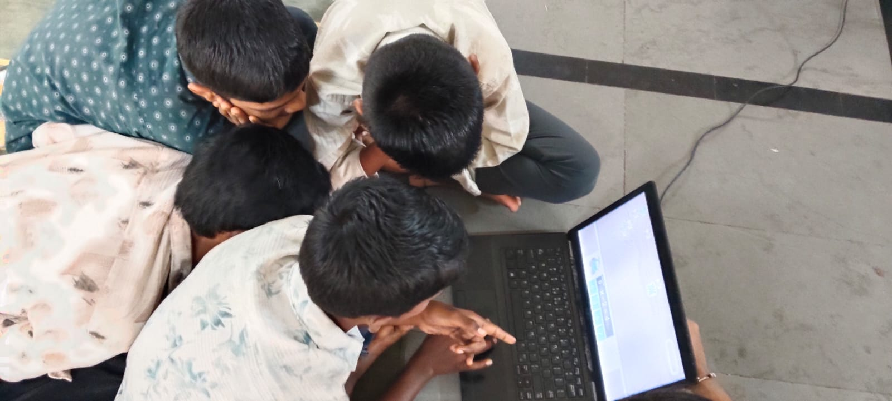

+++
contributor = "sneha"
title = "Sneha Gurav - Week 5"
date = 2026-11-12
draft = false
author = "Sneha Gurav"
role = "Researcher & Documentation Intern"
week = 5
emoji = "🧠"
+++



## 🧠 Sneha Gurav

### Beyond the Right Answer

*Researcher & Documentation Intern · Research Article · Social Science Education*

*Exploring prediction-based learning through a Kannada Social Science quiz.*

**Researcher & Documentation: Sneha Gurav**

*Students gathered around a laptop screen during the General Knowledge Day quiz activity.*

Quizzes are among the most familiar tools in any classroom, yet their learning value is easily misjudged. A score records whether an answer was right; it says little about the thinking that produced it. The moment before an answer, when a student recalls what they know, weighs possibilities and commits to a prediction, may be where much of the educational value lies.

#### Background

Social Science helps students make sense of society, history, geography, civic life and the wider world. General knowledge questions are a natural way to bring these ideas into conversation. The General Knowledge Day quiz was conducted in Kannada and used a prediction-based approach: students were encouraged to think about possible answers, interact with the quiz and respond. Using Kannada gives students the chance to take part in the language of the activity; it should not be assumed, on its own, to improve comprehension.

#### Purpose

This article examines prediction-based questioning as an approach to student participation, knowledge recall, classroom interaction and formative assessment. It draws on documented observations of participation, engagement and responses, and treats them as a starting point for discussion rather than as measured results.

#### Guiding Research Questions

1. How can prediction-based questions encourage students to think before answering?
2. What can students' responses reveal about their existing knowledge and areas of uncertainty?
3. How can teachers use quiz responses to guide explanations and future lessons?

---

### Thinking Before Answering

#### 01 · Understanding the quiz approach

The General Knowledge Day – Social Science Quiz was a Kannada-language activity built around prediction. Rather than waiting to be told an answer, students were invited to consider what it might be and respond. The sequence below is a recommended way to understand and strengthen the activity; it is not a record that each stage was formally measured on the day.

**Question → Prediction → Response → Feedback → Reflection**

#### 02 · The educational value of prediction

Asking students to predict can create opportunities to the following. These are potential benefits, not guaranteed outcomes for every student.

- Recall information they already know.
- Connect the question with earlier concepts.
- Consider possible answers before responding.
- Recognise uncertainty and gaps in understanding.
- Reconsider an answer after feedback.

#### 03 · What the observations can tell us

The documented observation areas are participation, engagement, interaction, prediction attempts and responses in Kannada. Visible enthusiasm does not by itself prove deep understanding, so it helps to keep four indicators distinct:

- **Participation** shows that a student is taking part.
- **A prediction** shows an attempt to formulate an answer.
- **An accurate answer** is evidence of knowledge of that particular question.
- **An explanation** can show how the student understands the concept.

#### 04 · Language and expression

Conducting the quiz in Kannada gives the activity a consistent language context. When a response is incomplete, a teacher should consider several possibilities: limited subject knowledge, difficulty understanding the question, uncertainty about a term, or difficulty putting an answer into words. The reason should not be assumed without further observation.

---

### What a Quiz Can Reveal

#### 05 · Looking beyond correct answers

A final answer offers only part of the picture. These are useful observation questions for future sessions, not confirmed findings from the original quiz.

- Did the student attempt a prediction?
- Could they explain their reasoning?
- Did they revise after feedback?
- Were they confident, uncertain or seeking clarification?
- Did the response reveal a possible misconception?
- Could they apply the idea to a new example?

#### 06 · From quiz responses to formative assessment

Responses can guide what happens next. The examples below are instructional illustrations, not events documented in the session.

| Student response | What a teacher could do |
|---|---|
| **Correct and explained** | Offer a new question that requires application rather than recall. |
| **Incorrect but attempted reasoning** | Identify the reasoning that needs clarification and address the underlying concept. |
| **Hesitation or no answer** | Rephrase the question, add context, or revisit the concept. |
| **Correct but unable to explain** | Ask a follow-up to separate understanding from guessing or memorisation. |

#### 07 · A more meaningful way to assess learning

Participation and excitement should not be treated as proof of learning. A stronger approach combines answer accuracy, brief reasoning, feedback and a chance to try again. The table is a proposed observation framework, not a dataset from the original session.

| Observation area | What to look for |
|---|---|
| **Participation** | Attempts to respond or contribute |
| **Prediction** | Ability to propose a possible answer |
| **Understanding** | Accuracy and quality of explanation |
| **Reflection** | Ability to reconsider an answer after feedback |
| **Application** | Ability to use the concept in a new example |

#### 08 · What remains to be investigated

The documented observations are a starting point. They do not establish measurable knowledge gains, long-term retention, or improvement compared with another teaching method. Future sessions could gather clearer evidence through light-touch notes on responses and reasoning, without making the activity stressful or test-like.

---

### A Model Teachers Can Use

#### 09 · A practical model for teachers

1. **Ask a clear question.** Use age-appropriate language and test one specific concept.
2. **Give thinking time.** Let students consider an answer before inviting responses; don't reveal it too soon.
3. **Invite predictions.** Allow speaking, a short written answer, or choosing an option.
4. **Ask for reasoning.** A brief follow-up such as "What makes you think that?" shows the basis of an answer.
5. **Give informative feedback.** Explain the concept, correct misconceptions respectfully, and acknowledge sound reasoning even when the final answer needs correction.
6. **Offer another opportunity.** Ask a related question or give a new example to apply the idea.
7. **Record useful observations.** Note participation, accuracy, reasoning and responses after feedback, and evaluate the session on that evidence.

#### 10 · Recommendations for future sessions

- Mix recall, understanding and application questions.
- Treat incorrect answers as chances to address misconceptions.
- Use clear Kannada wording suited to the learners.
- Explain why an answer is correct or incorrect.
- Allow enough time to think; reward explanations, not speed alone.
- Use a small observation sheet to record responses consistently.
- Create ways for quieter students to take part.
- Revisit selected questions later to explore retention, comparing responses only when the same concepts are assessed fairly and documented.

#### 11 · Conclusion

A meaningful quiz does more than collect answers. Designed thoughtfully, it can help students recall what they know, express their thinking, recognise uncertainty and learn from feedback. For teachers, the value lies in using those responses to guide the next stage of instruction. Prediction-based questioning is a practical approach worth exploring further in Social Science education, with its effects judged through careful observation rather than assumed from participation alone.

> "The answer tells us what a student selected. The reasoning can help us understand what the student learned."

---

*Pthoth × Swami Vivekanand Seva Pratisthan (SVSP), Belagavi · Internship Experience · Research & Documentation*

*Sneha Gurav · Researcher & Documentation Intern*