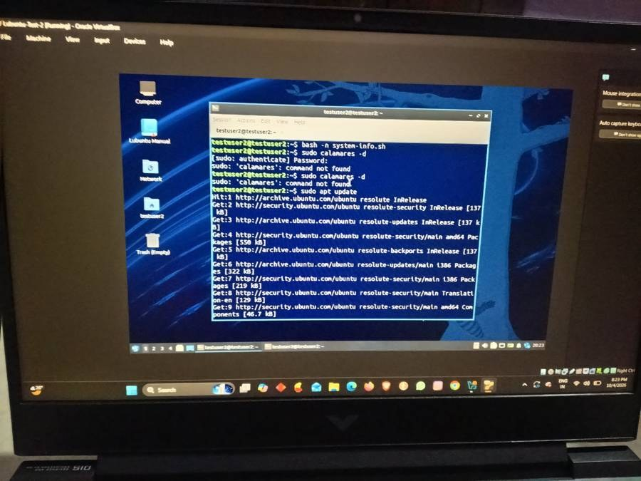
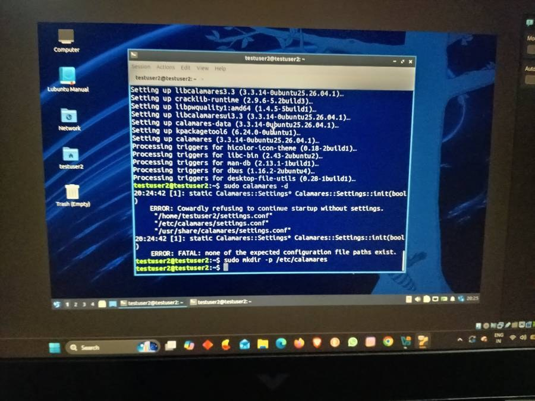
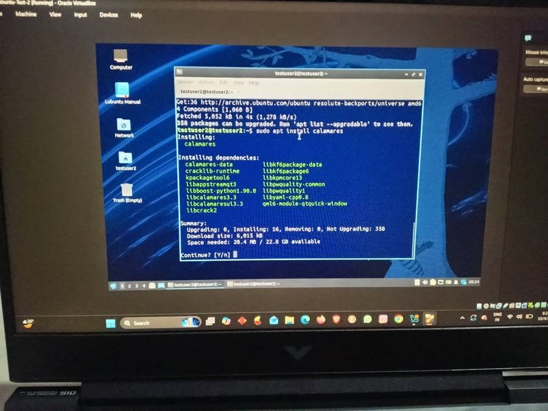
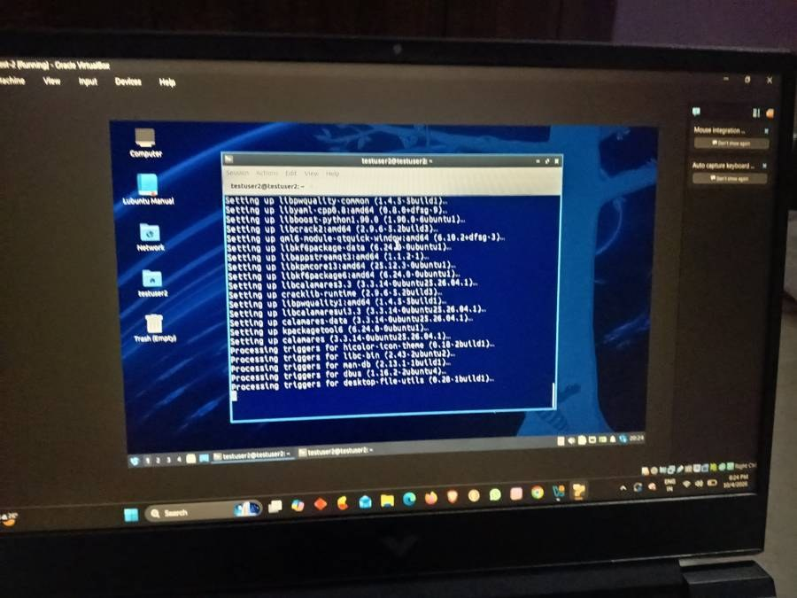
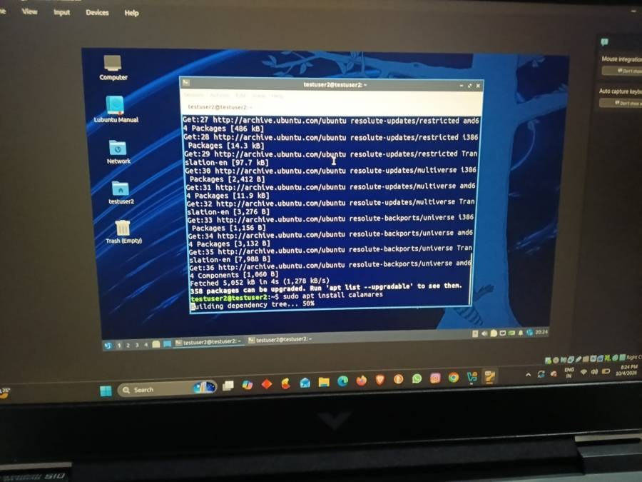

+++
contributor = "ummehabiba-kotwal"
title = "Ummehabiba Akeelahmed Kotwal - Week 5"
date = 2026-10-23
draft = false
author = "Ummehabiba Akeelahmed Kotwal"
role = "IT Manager Intern"
week = 5
emoji = "💻"
+++



## 💻 Ummehabiba Akeelahmed Kotwal

### System Configuration, Deployment Research and Calamares

*IT Manager Intern · EdTech Research Internship | Week 5 of 7*

After testing Lubuntu in a virtual environment, my work moved towards understanding how the same type of setup could eventually be reproduced on multiple computers.

The goal was to investigate a practical deployment process for several low-specification systems while avoiding unnecessary manual configuration on every machine.

#### Building a Repeatable Configuration

I created and tested shell scripts for tasks such as:

- Collecting system information.
- Applying basic configuration.
- Creating startup configuration.
- Setting executable permissions.
- Checking whether the configuration had been applied successfully.

*Checking the system-info.sh script with `bash -n` inside the Lubuntu VM*

I also tested automatic startup behaviour and keyboard shortcuts. This introduced me to an important IT management concept:

> A setup becomes easier to maintain when repetitive configuration can be documented and automated.

#### Preparing a Bootable USB

I also successfully prepared a bootable Lubuntu USB using Rufus.

The process involved selecting the Lubuntu ISO and creating a bootable installation medium suitable for testing on a physical computer.

The USB could then be used to boot a system and reach the Lubuntu "Try or Install" environment.

This gave me practical exposure to the steps between downloading an operating system and actually preparing a machine for installation.

#### Researching Calamares

Another major part of my work was researching Calamares, the installer used by Lubuntu. I investigated its configuration structure, including:

- `settings.conf`
- Partition configuration
- User configuration
- Installer modules
- Branding/configuration directories

*Running `sudo calamares -d` reports that no settings.conf exists at the expected paths; `/etc/calamares` is then created with `mkdir`*

*Installing Calamares with apt in the Lubuntu VM: 16 packages, about 20.4 MB of space needed*

*Setting up Calamares 3.3.14 and its dependencies*

I also examined how partitioning and user-creation steps are represented in the configuration.

*Updating package lists and starting the Calamares installation*

Rather than immediately changing the live installer, I backed up the existing configuration and created a separate test configuration for investigation.

I also checked the installed Calamares version and explored its command-line/configuration capabilities.

#### Why We Did Not Immediately Automate Everything

One of the most important lessons was that automation should not come before understanding the environment.

The target computers may have differences in:

- BIOS/UEFI configuration.
- Existing partitions.
- Disk capacity.
- Hardware.
- Boot configuration.
- Number of drives.

Therefore, the safer approach was:

**Build one reliable configuration → Test it → Document it → Reproduce it → Then consider wider deployment**

#### What I Learned

This week helped me understand the difference between installation and deployment.

Installing an operating system once is relatively straightforward.

Preparing a repeatable environment for multiple machines requires planning, testing, configuration management, documentation and consideration of hardware differences.

That is a much closer representation of real IT administration work, and it helped me connect my classroom knowledge with practical system management.

*Written by Ummehabiba Akeelahmed Kotwal, IT Manager Intern. IT Manager internship with Pthoth in collaboration with Swami Vivekanand Seva Pratisthan (SVSP), Belagavi*
