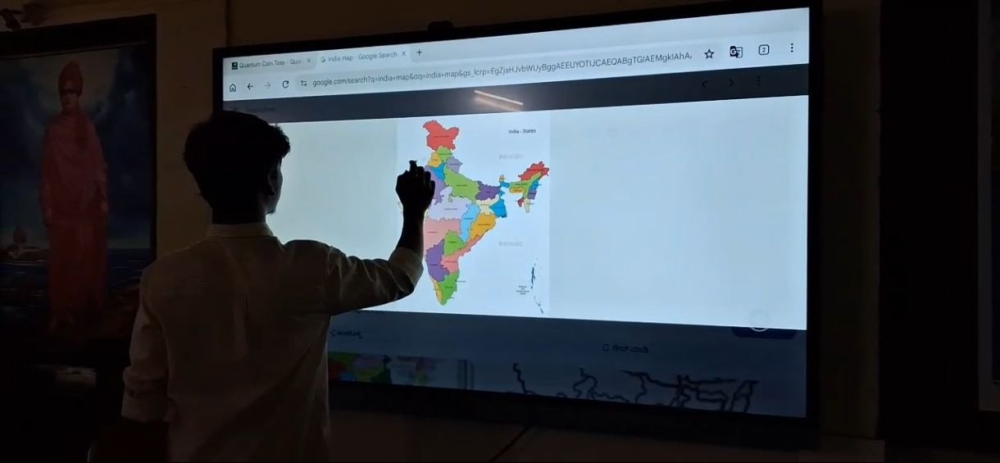
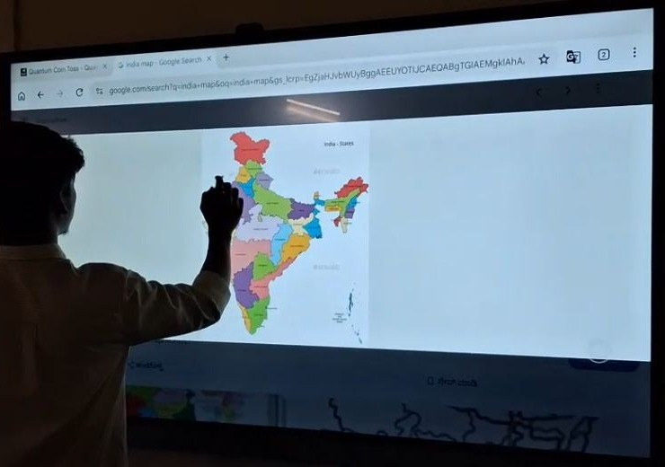

+++
contributor = "vishwas-karikatti"
title = "Vishwas Karikatti - Week 5"
date = 2026-10-23
draft = false
author = "Vishwas Karikatti"
role = "Teacher Intern"
week = 5
emoji = "👨‍🏫"
+++



## 👨‍🏫 Vishwas Karikatti

### Learning Through Interactive Smart Board Activities

*Teacher Intern · Internship Journal | Week 5*

**Branch:** Robotics and Artificial Intelligence · **College:** Maratha Mandal Engineering College · **Organisation:** Pthoth, in collaboration with Swami Vivekanand Seva Pratisthan (SVSP), Belagavi

#### 1. Introduction

In the first week I learned what teaching involves, in the second week I began applying it with better planning and questioning, in the third week I focused on building confidence and student participation, and in the fourth week I used quizzes to make learning fun. In the fifth week I wanted to move from showing content to the students to letting them interact with it directly. I used the interactive smart board in the Kendra and invited students to come forward, touch the screen and explore a map of India themselves. I saw them become more confident and curious when they were the ones leading the activity.

#### 2. Objectives for the Week

- To use the interactive smart board to make lessons more visual and hands-on.
- To give students the chance to come forward and take part in the activity themselves.
- To help students understand geography by locating states and regions on a map.
- To keep using mentor feedback to improve my lessons.

#### 3. Activities Undertaken

**Classroom sessions.** Sessions were held at the Kendra, and this week the smart board became the centre of the lesson. I continued to plan my questions in advance and kept explanations short, so that more time was left for the students to interact with the screen.

**Map activity.** I opened a map of India showing all the states on the smart board. Students came forward one by one, and each was asked to point to a state or region on the touch screen. The rest of the group watched, helped with hints and checked whether the answer was correct. After each turn I explained the location and one simple fact about that place.

*Figure 1: A student pointing to a state on the India map displayed on the smart board at the SVSP Kendra.*

**Using an open-source resource.** For the map I used freely available, open-source material (see Resources). The colour-coded states made it easy for students to tell neighbouring regions apart, and the large touch screen made the activity feel like a game rather than a lesson.

*Figure 2: The colour-coded map of Indian states used for the activity (close-up of the board).*

#### 4. What I Learned

- Letting students touch and interact with the screen keeps them far more attentive.
- A visual map helps students remember places better than a spoken explanation alone.
- Students who rarely speak became more confident when they were invited to come forward.
- Explaining a short fact after each answer turns a simple pointing task into real learning.
- Regular feedback from mentors helps me improve with every session.

#### 5. Challenges and Improvements

The room was dark during the activity, which made it hard for students at the back to see the details on the map, and the small state names were difficult to read from a distance. Some students were also hesitant to come forward. Going forward, I plan to adjust the lighting, zoom into regions so that the text is easy to read, and work in pairs so that shy students feel comfortable. I also want to add short questions about rivers, capitals and neighbouring states.

#### 6. Resources

- Wikipedia – [States and union territories of India](https://en.wikipedia.org/wiki/States_and_union_territories_of_India) (open content)
- OpenStreetMap – [open-source world map](https://www.openstreetmap.org)
- Wikimedia Commons – [free-to-use maps of India](https://commons.wikimedia.org)

#### 7. Key Takeaway

Week 5 showed me that students learn best when they are active participants and not just listeners. The smart board helped them see, touch and explore, and it helped me understand how much they had grasped. My confidence and teaching skills continue to grow with every session, and I look forward to learning more from my students and mentors in the coming weeks.
