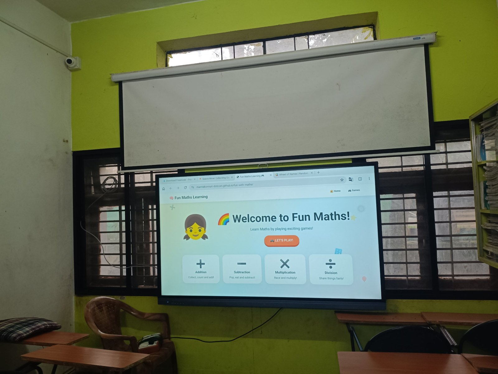
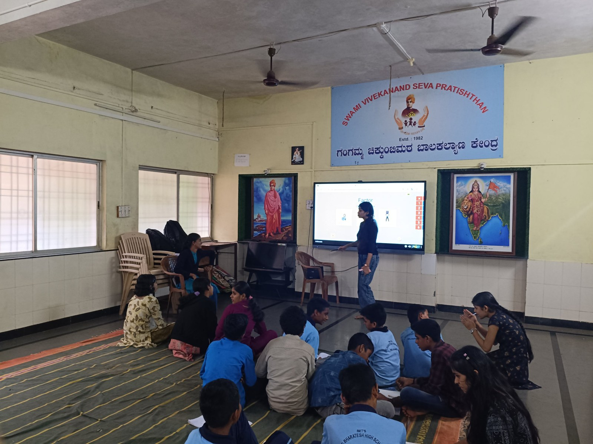
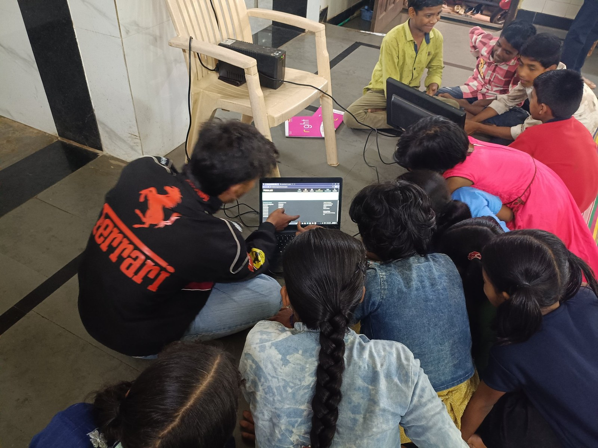
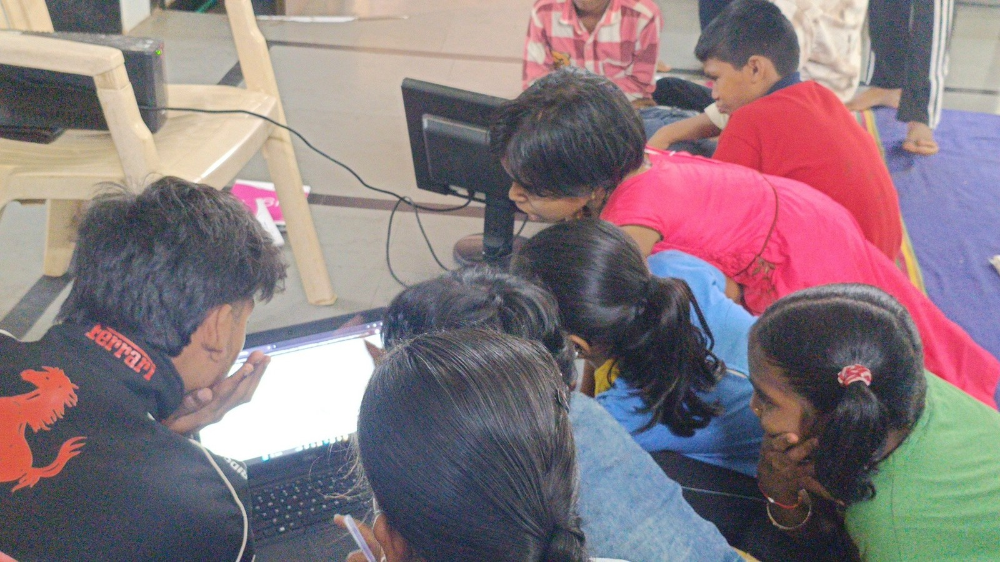
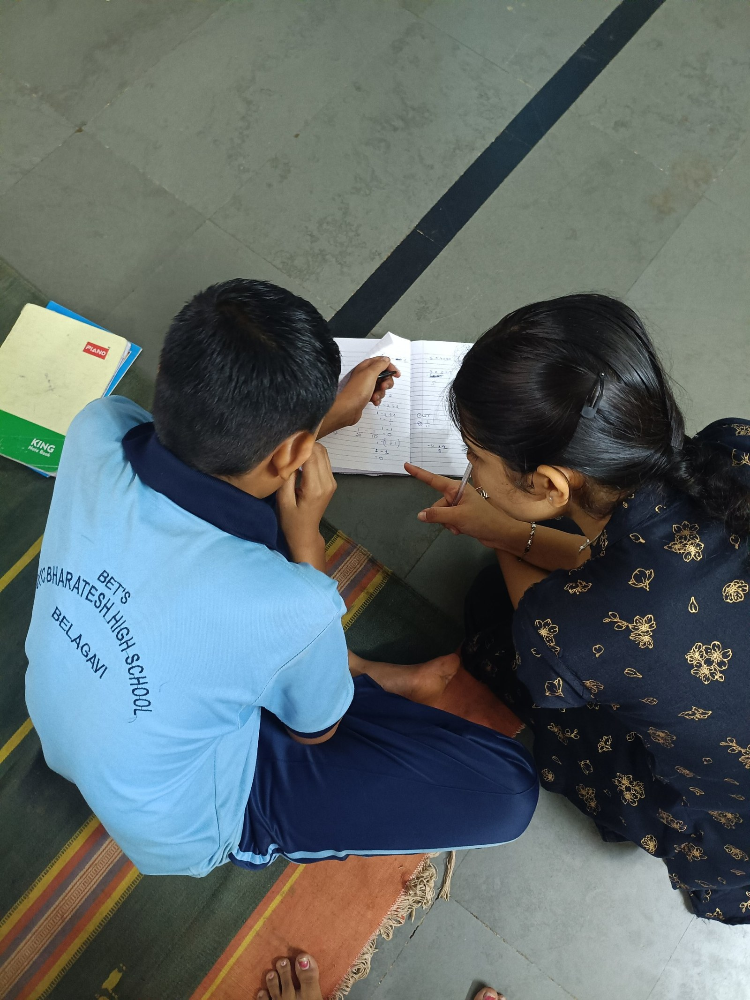

+++
contributor = "pavitra-madiwal"
title = "Pavitra Madiwal - Week 6"
date = 2026-10-23
draft = false
author = "Pavitra Madiwal"
role = "Content Creator Intern"
week = 6
emoji = "🎨"
+++



## 🎨 Pavitra Madiwal

### Week 6 Progress Report: Workflow Optimization, Multi-Channel Planning & Supervisory Handover

*Content Creator Intern · Internship Journal | Week 6*

| | |
|---|---|
| **Module / Focus** | Final System Handover |
| **Timeline** | Week 6 |
| **Active Platform** | Buffer Production Workspace |
| **Status** | Ready for Execution |

#### Executive Summary

During Week 6, operations were finalized by standardizing the weekly posting calendar inside Buffer, establishing best practices for visual post creations, preparing documentation for supervisors, and setting up the roadmap for multi-platform content scheduling.

#### Key Activities & Milestones

**1. Publishing Rhythm & Calendar**

- Established consistent weekly posting time slots in Buffer dashboard.
- Optimized caption structures, hashtag banks, and visual media sizing.
- Set up content review processes to ensure error-free automated publishing.

**2. Reporting & Handover Preparation**

- Compiled complete 6-week documentation and technical progress logs.
- Structured weekly PDF reports for website profile upload and supervisory review.
- Prepared operational guidelines for ongoing daily social media scheduling.

#### Final Operational Status

| System Component | Configuration State | Operational Readiness | Status |
|---|---|---|---|
| Buffer Workspace | Configured with publishing schedule & time zones | Fully Operational | Ready |
| Connected Channels | Instagram Business Account linked via API | Automated Publishing Enabled | Active |
| Documentation & Reports | 6-Week PDF Progress Reports completed | Ready for Profile / Management Upload | Finalized |

#### 6-Week Cumulative Impact

**Final Conclusion:** Successfully navigated from initial video editing and research (Weeks 1–2), through technical setup challenges with Postiz (Week 3), to a fully functional, cloud-managed social media scheduling system on Buffer (Weeks 4–6). The deployment is now complete and ready for regular daily execution.

#### Photo Documentation

Photographs from the learning sessions documented during Week 6.

*Figure 6.1: Fun Maths learning site open on the smart board.*

*Figure 6.2: Students and facilitators during a smart board session.*

*Figure 6.3: Students gathered around a laptop during a session.*

*Figure 6.4: Another view of the group session at the laptop.*

*Figure 6.5: One-to-one help with a maths exercise.*
