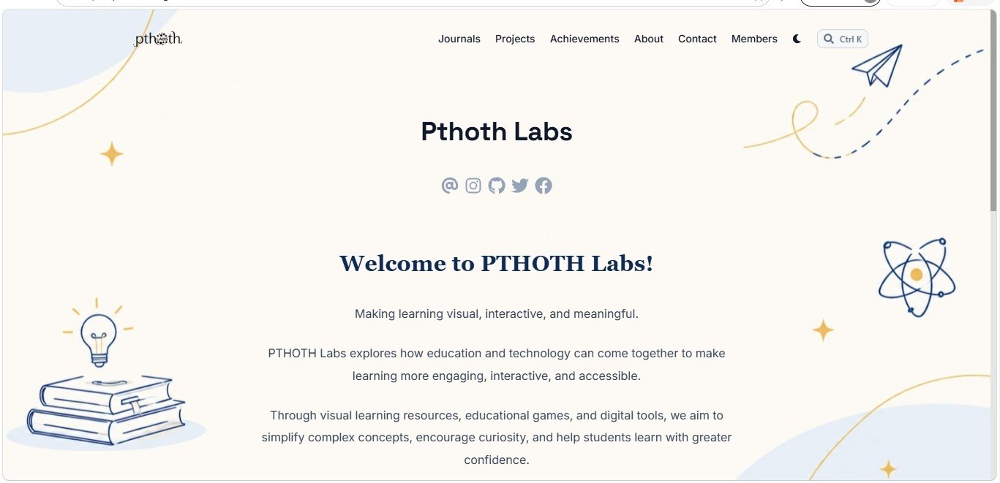
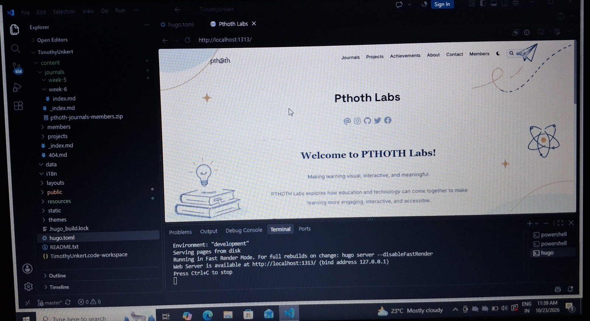

+++
contributor = "rakshita-pawar"
title = "Rakshita Pawar - Week 6"
date = 2026-10-23
draft = false
author = "Rakshita Pawar"
role = "Social Media Manager Intern"
week = 6
emoji = "📱"
+++



## 📱 Rakshita Pawar

### Building the Complete Website and Pushing It to GitHub

*Social Media Manager Intern · Internship Journal | Week 6*

In Week 6, the Hugo learning from Week 5 turned into a finished product. I built the complete PTHOTH Labs website, worked through the problems that came up, committed all the changes and pushed the working website to GitHub. After starting with a tutorial and a few configuration files last week, it was a good feeling to see the whole site running as one working project.

#### 01 | Building the Complete Website

Last week I learned the main parts of a Hugo project: the **content**, **layouts**, **themes** and **static** folders and the `hugo.toml` configuration file. This week I used that understanding to put the whole website together. The site uses the Blowfish theme, and its configuration holds the base URL, title, author details and the social links for email, Instagram, GitHub, X and Facebook.

*Figure 6.1: The finished PTHOTH Labs website, showing the home page with the Journals, Projects, Achievements, About, Contact and Members menu.*

I kept `hugo server` running while I worked. Each time I saved a file, the terminal rebuilt the site and I could check the result in the browser straight away. This made it easy to build step by step and to notice mistakes early.

*Figure 6.2: The complete project in VS Code, with the website running locally through the Hugo server at localhost:1313.*

#### 02 | Solving the Problems

A complete build rarely works the first time. As the site grew, I ran into problems with pages, content and configuration, and I worked through them one at a time with the help of my seniors. By the end of the week, all the problems I had found were solved and the website ran correctly. Fixing them gave me a much better understanding of how the content, layouts and configuration depend on each other.

#### 03 | Committing All the Changes

Once the website was working, I committed all the changes in the project. Committing saves the work in Git with a clear record of what changed, so nothing depends on a single copy on one computer. It also meant the project was in a clean, finished state before it went online.

#### 04 | Pushing the Website to GitHub

The final step was pushing the complete, working website to GitHub. The site's base URL points to the PTHOTH Labs GitHub address, so GitHub is where the website lives and where the team can see and update it. Pushing the project made the week's work available to everyone on the team instead of staying on my own computer.

#### 05 | How This Work Supports My Role

- **Complete website:** Brings together everything I learned about Hugo into one working project.
- **Problem solving:** Helped me understand how the parts of the site connect.
- **Commits:** Keep a clear record of the work and keep the project safe.
- **GitHub push:** Puts the website where the whole PTHOTH Labs team can use it.

#### 06 | Learning & Outcome

Week 6 took me from learning Hugo to delivering a finished website. I built the complete site, solved the problems that came up, committed all the changes and pushed the working project to GitHub. This showed me that building a website is not only about writing pages, but also about testing, fixing and saving the work properly.

#### 07 | Next Steps

- Keep improving and maintaining the website now that it is on GitHub.
- Make sure the social links on the website match our active accounts.
- Keep committing changes regularly so the project history stays clear.
- Keep asking my seniors for guidance and apply their feedback.

#### Week 6 Reflection

This week I learned that a project is only finished when it works, is saved and can be shared. Building the whole website was a big step from last week's first experience with Hugo, and with the help of my seniors, every problem on the way was solved. Seeing the finished site on GitHub made all the earlier learning feel worthwhile.
