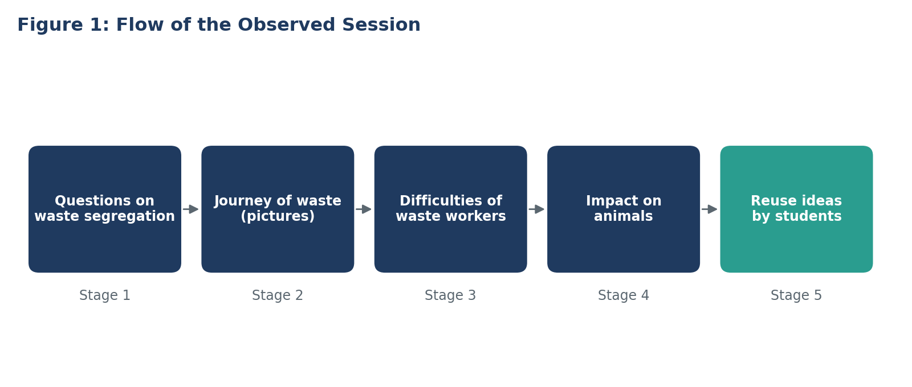
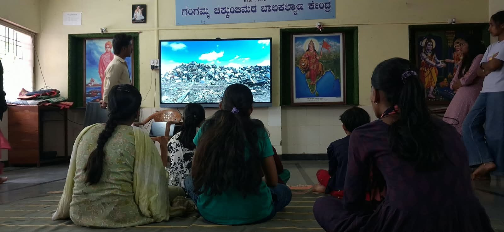
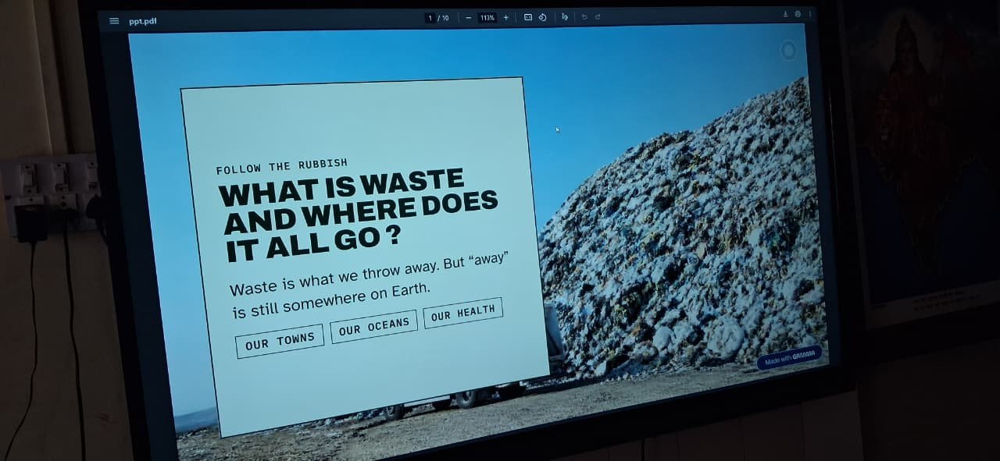
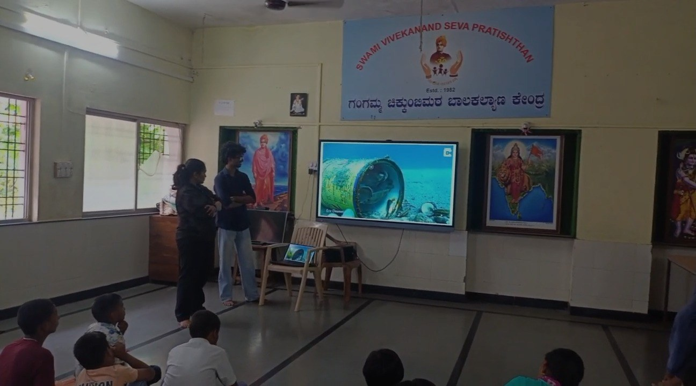
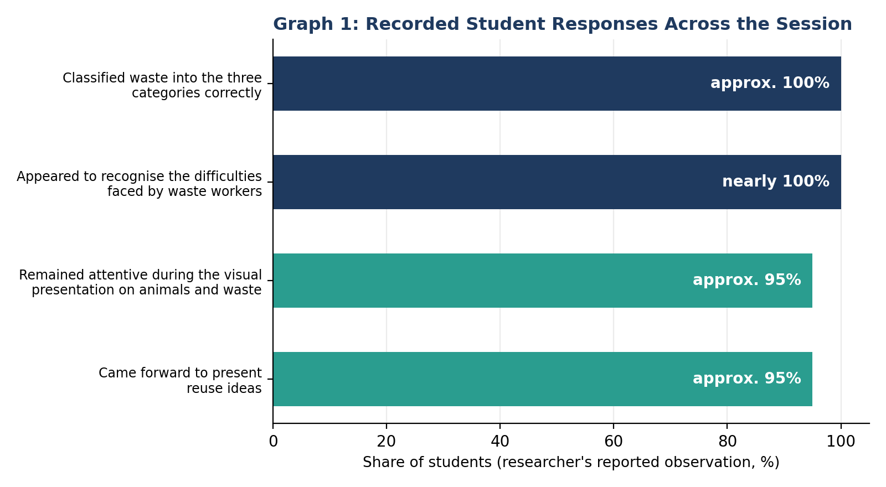

+++
contributor = "shreya"
title = "Shreya Hebbalkar - Week 6"
date = 2026-10-23
draft = false
author = "Shreya Hebbalkar"
role = "Researcher and Documentation Intern"
week = 6
emoji = "🔬"
+++



## 🔬 Shreya Hebbalkar

### From Segregation to Empathy: A Researcher's Observations on Waste Management, Environmental Awareness and Creative Problem-Solving in a Mixed-Age Classroom Session

*Researcher and Documentation Intern · Internship Journal | Week 6*

| | |
|---|---|
| **Researcher** | Shreya Hebbalkar |
| **Role** | Researcher and Documentation Intern |
| **College** | Maratha Mandal Engineering College, Belagavi |
| **Organisation** | Pthoth, in collaboration with Swami Vivekanand Seva Pratisthan (SVSP), Belagavi |
| **Research topic** | Waste Management, Environmental Awareness, Empathy and Creative Problem-Solving |

#### 1. Abstract

This article presents my observations of an interactive session on waste management conducted with students from different age groups, approximately 3rd to 10th standard, in a single session. The session combined questions, pictures, explanations and open-ended activities. I observed how students responded to waste segregation, to the journey of waste after disposal, to the difficulties faced by people who manually separate mixed waste, to the impact of waste on animals, and to an activity in which they suggested ways of reusing discarded items.

As I recorded, approximately 100% of students classified waste into three categories correctly, nearly 100% appeared to recognise the difficulties faced by waste workers, and approximately 95% remained attentive during the visual presentation on animals and came forward to present reuse ideas. The main insight was that students appeared to respond more strongly to human and animal consequences than to environmental images alone. These figures are my reported observations and are not a formal measure of learning.

#### 2. Keywords

Waste management; waste segregation; environmental awareness; empathy; creative problem-solving; student participation; classroom observation; reuse.

#### 3. Introduction

Most students have heard that waste should be separated, but knowing a rule is different from understanding why it matters. As a Researcher and Documentation Intern with Pthoth, in collaboration with Swami Vivekanand Seva Pratisthan (SVSP), Belagavi, I wanted to observe whether a session could take students from the basic idea of segregation to a wider awareness of how waste affects people, animals and the environment, and whether students could then think of practical solutions themselves.

My contribution in this study was to observe the session closely, record what students did and how they responded, separate my direct observations from my interpretations, and document the findings in an organised way. This article presents that work.

#### 4. Background and Purpose of the Study

Waste-management education often stops at classification: which item goes in which bin. The session I observed was designed to go further. It aimed to connect everyday waste-disposal habits with real-world consequences, to build empathy for the people and animals affected, and to give students an opportunity to contribute their own ideas. My purpose as a researcher was to observe:

- What students already knew about waste segregation.
- How they responded to pictures and explanations about the journey of waste.
- Whether they recognised the difficulties faced by waste workers.
- How they responded to examples of animals harmed by waste.
- How willing and able they were to suggest ways of reusing discarded items.

#### 5. Research Context and Approach

The session was conducted with students from approximately 3rd to 10th standard in a single session. It followed an interactive approach: students were first asked questions to understand their existing knowledge, and their responses were followed by pictures, explanations or demonstrations.

My approach was direct observation. I recorded approximate percentages for key responses, noted individual differences, and wrote a separate researcher's observation for each stage, so that what I saw and what I interpreted were kept apart. The percentages describe the reported share of students in each observation. They are not test scores.

*Figure 1. The five stages of the observed session, in the order they took place.*

#### 6. Observations and Analysis of the Session

**6.1 Waste segregation: starting from what students knew**

The session began with questions on classifying waste into three dustbins. I recorded that approximately 100% of students classified waste into the three categories correctly. Students were familiar with the concept because they had previously taken part in a session or game on waste segregation. I interpreted this as a sign that earlier learning activities had helped, and it meant the session could move beyond basic classification to the consequences of improper disposal.

**6.2 The journey of waste: human consequences over environmental images**

Students were shown pictures of what happens after waste is discarded, and the difference between disposing of mixed waste and separating it before disposal. During my observation, the environmental images alone did not produce a strong visible emotional response among most students. A more noticeable reaction came when the session focused on people who manually separate mixed waste. My interpretation is that students responded more strongly to the human consequences than to environmental images alone, which suggests that environmental issues are better connected to real-life human experience.

*Students watching visual material on the classroom display during the session.*

*A slide from the session presentation introducing the question of what waste is and where it goes.*

**6.3 Difficulties faced by waste workers**

The session described the difficulties of people who manually separate mixed waste: unpleasant smells, exposure to dirty materials, skin problems and the risk of disease. I recorded that nearly 100% of students appeared to recognise these difficulties, and they showed emotional understanding of the discomfort and health risks involved. The discussion helped students connect their everyday disposal habits with the working conditions of waste handlers. I interpret this part of the session as creating the strongest link between students' actions and their consequences for others, and it reinforced why waste should be separated before disposal.

**6.4 Impact of improper waste disposal on animals**

Students were shown examples of cows eating plastic along with food waste, and of birds becoming trapped in discarded waste near water. Approximately 95% of students remained attentive during this presentation. One student appeared less interactive or attentive than the others. Two to three students showed a stronger emotional response to images of animal suffering, and younger students appeared particularly affected by some of the images. My interpretation is that visual examples of animal suffering helped students recognise the importance of responsible waste management, although I recorded these emotional responses as observations of a few students and not of the whole group.

*Students during the session with visual material shown on the classroom display.*

**6.5 Reusing waste: from understanding to solutions**

After discussing the problems, students were invited to suggest ways to reuse discarded items such as plastic bottles. Rather than giving all the answers, the session asked students to come forward and share their own ideas. Approximately 95% of students came forward, several volunteered more than once, and students suggested creative ways to turn waste into useful products. I interpret this as creative thinking and an ability to apply the concept of reuse to everyday objects, and the repeat volunteering as continued interest.

One student did not come forward, although the student appeared to know the answer. I noted that this student should not automatically be considered unaware of the topic: the observation suggested hesitation to speak in front of the group. This reminded me to consider both knowledge and willingness to participate.

#### 7. Data Analysis and Graphical Representation

Table 1 lists the numerical observations recorded in my report, and Graph 1 shows them. All values are approximate and come from my reported observations.

| Stage of the session | Recorded observation | Reported value |
|---|---|---|
| Waste segregation | Students classified waste into the three categories correctly | Approximately 100% |
| Difficulties of waste workers | Students appeared to recognise the difficulties faced by these workers | Nearly 100% |
| Impact on animals | Students remained attentive during the visual presentation | Approximately 95% |
| Reuse activity | Students came forward to present their ideas | Approximately 95% |

*Graph 1. Recorded student responses across the session. The bars describe different observations and are not scores on a single test.*

**What the data indicate.** The recorded values show high knowledge of basic segregation, near-universal recognition of the difficulties faced by waste workers, and high attention and participation in the animal and reuse activities. They also need careful reading. Attention is not the same as understanding, and coming forward to present an idea is an indicator of engagement, not proof of learning. The single student who did not come forward appeared to know the answer, which shows that participation figures can understate knowledge. Some findings are qualitative and have no percentage: the weaker response to environmental images alone, the stronger response to human consequences, and the emotional reactions of two to three students.

#### 8. Key Findings

- **Existing knowledge:** students were already familiar with basic segregation and could classify waste into three categories.
- **Human impact:** explanations about the difficulties of waste workers appeared to produce a stronger emotional response than environmental images alone.
- **Animal welfare:** visual examples of animals affected by plastic and other waste attracted considerable attention and emotional responses among several students.
- **Creative problem-solving:** students suggested ways to reuse discarded items and turn them into useful products.
- **Participation and engagement:** approximately 95% volunteered to present ideas, some more than once, while one student appeared to know the answer but did not volunteer.

#### 9. Discussion

Taken together, the observations suggest that the session worked by moving step by step: it began from what students already knew, then widened to consequences for people and animals, and finally asked students to propose solutions. Students appeared to connect more with consequences that involved people and animals than with environmental images alone, which points to the value of empathy as a way into environmental topics.

The findings also suggest that open-ended activities give students room to contribute, and that a mixed-age group can take part in the same session. At the same time, I interpret these findings cautiously. They are observations from one session, and the emotional responses, especially those of younger students, were noted for a few students only. I cannot say from this report that the session changed students' habits.

#### 10. Challenges and Limitations

- The percentages reflect my reported observations. They are not a formal measure of learning.
- Volunteering more than once is an indicator of engagement, not proof of understanding.
- One student appeared less attentive during the animal presentation, and one student did not come forward in the reuse activity, so participation was not uniform.
- Emotional responses were noted for only a few students, so they should not be applied to the whole group.
- The group included a wide age range, from approximately 3rd to 10th standard, and results were not recorded separately for each age group.

#### 11. Recommendations

The following are recommendations for future sessions. They are not findings of the present study.

- Connect environmental topics with human experiences, as students responded strongly to the difficulties of waste workers.
- Use visual examples, including those about animals, with care for younger students who may be affected by some images.
- Keep open-ended activities in which students suggest their own solutions.
- Look for quieter ways, such as small groups or writing, for hesitant students to share what they know.
- Follow up with a simple check of learning, so that engagement can be separated from understanding.
- Record the number of students and results by age group in future observations.

#### 12. What I Learned as a Researcher

**Observation goes beyond right answers.** Approximately 100% of students classified waste correctly, which could have ended my interest in that stage. Instead, it taught me that a high score on a basic task can mean the topic is already familiar, and that the real research question lies in what comes next.

**Separating observation from interpretation.** For every stage, I wrote what I observed and what I thought it meant in separate parts. I learned that this habit protects the findings: a student's strong reaction is an observation, while "the images helped them recognise the importance of waste management" is my interpretation, and I should say which is which.

**Participation is not the same as knowledge.** The student who did not come forward appeared to know the answer. This showed me that a participation figure can hide knowledge as well as overstate it, and that I should consider both knowledge and willingness to speak.

**Looking at who responds to what.** I noticed that the emotional responses came from particular students, and that younger students seemed particularly affected by some images. I learned to record individual differences instead of describing the whole group in one sentence.

**Being careful with numbers.** Writing my research note made me realise that percentages from observation are useful for communicating a session clearly, but they should not be treated as test results. I learned to label them honestly.

**My development.** Together, these lessons moved me from describing a session to analysing it. As a documentation intern, I now try to record not just what happened but how students responded, what I saw directly, and what I inferred, so that the work is useful for evaluating educational activities.

#### 13. Conclusion

The session I observed moved beyond teaching basic waste segregation. It encouraged students to consider the effects of improper disposal on people, animals and the environment, and it gave them a chance to think creatively and propose practical solutions. My observations show high familiarity with segregation, strong recognition of the difficulties faced by waste workers, high attention to the animal presentation, and high participation in the reuse activity.

The observations suggest that combining environmental awareness with discussion and problem-solving can make waste-management sessions more interactive and meaningful for students of different age groups. These findings come from a single session and my reported observations, and they should not be treated as a formal measure of learning or generalised without further research. For me, the work was a lesson in careful observation, honest reporting and connecting evidence with interpretation, and it has strengthened my development as a researcher and documentation intern.
