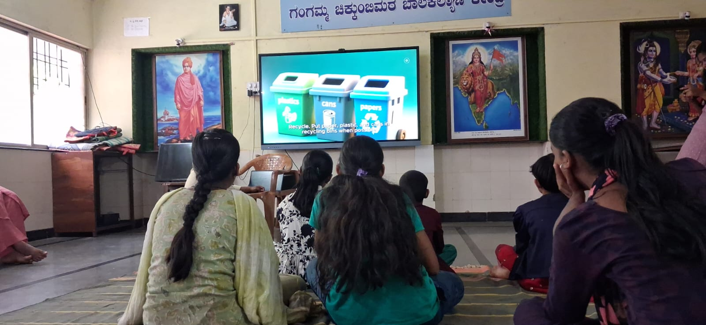
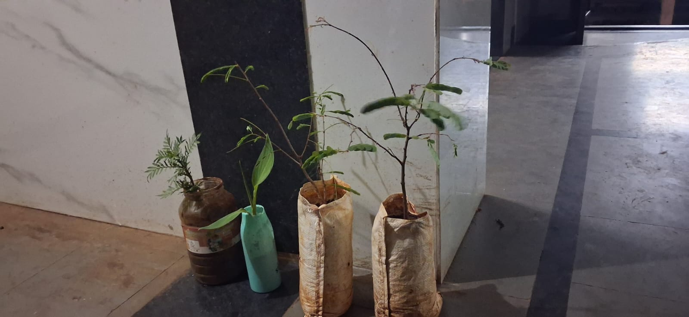
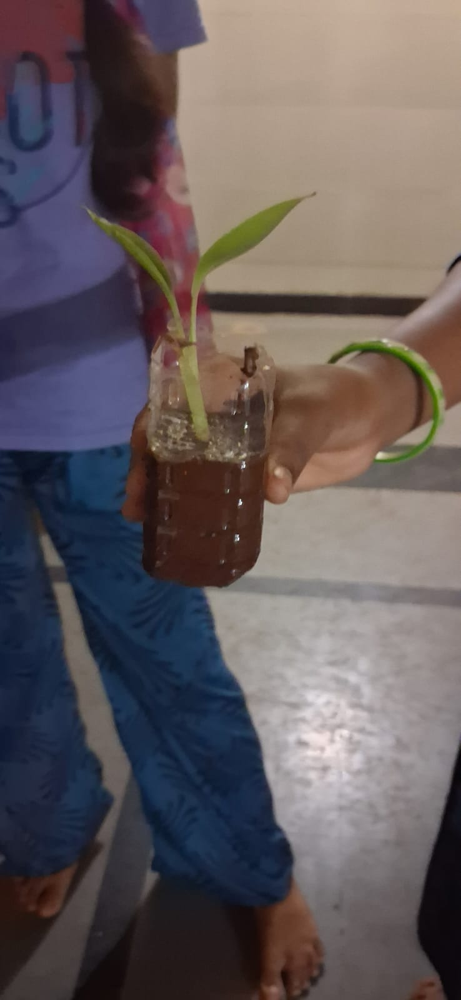
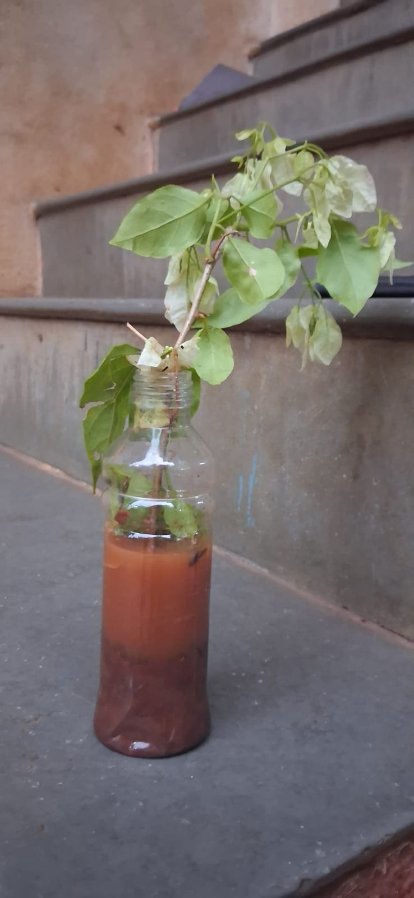

+++
contributor = "sneha"
title = "Sneha Gurav - Week 6"
date = 2026-11-12
draft = false
author = "Sneha Gurav"
role = "Researcher & Documentation Intern"
week = 6
emoji = "♻️"
+++



## ♻️ Sneha Gurav

### Beyond the Bin

*Researcher & Documentation Intern · Observational Article*

*An observational study of waste awareness, human impact, empathy and student-led problem-solving.*

**By Sneha Gurav**, Robotics and Artificial Intelligence student · Research & documentation

#### Abstract

Waste education often begins with placing items in the correct bin. That is an important starting point, but understanding waste also means asking where it goes, how it affects animals and people, and what can be done before it is thrown away. This article reflects on observed waste-awareness activities that used visual examples, discussion and a reuse activity to explore these wider connections.

The observations describe engagement and idea generation during the sessions. They do not, by themselves, show long-term learning or changes in behaviour.

*Waste awareness · Environmental education · Empathy · Reuse*

#### 01 · Looking beyond the bin

A bin can teach a child where an item belongs. It cannot explain what happens when waste is mixed, why plastic can harm living beings, or how disposal affects the people who handle it. These activities widened the focus from sorting waste to its journey and consequences.

#### 02 · Understanding the activity

The session brought together three connected questions: what students already know about waste, what they notice when they see its effects, and what solutions they can imagine themselves. The emphasis was not only on correct disposal, but on the reasoning and concern that can grow around it.

**What was observed**

Existing understanding of waste segregation; responses to plastic harming animals; awareness of the people who handle waste; questions about where waste goes; and practical reuse ideas offered by students.

Students were asked to think about segregation, view visual examples related to animals and people, and discuss what happens after waste is discarded. The reuse activity then gave them space to offer ideas rather than receive ready-made answers.

One observed session included students from approximately 3rd to 10th standard. Their familiarity with sorting made it possible to move the conversation towards the wider effects of waste. The observations here are descriptive: they record what students appeared to notice, ask and suggest.

*The waste-segregation presentation introduced familiar sorting categories as a starting point for a wider discussion.*

#### 03 · Seeing the consequences

**Where waste goes**

For many learners, waste is something that disappears after collection. Visual examples of landfills made its destination more concrete. Students asked how much waste exists around the world and what happens to all of it.

These questions widened the discussion from a single bottle to the larger system of collection, reuse, recycling and disposal, and opened a conversation about prevention: reducing waste, using items for longer and separating it responsibly.

**Animals and plastic**

Examples of plastic harming animals prompted emotional responses among some students. Images of animals eating plastic mixed with food waste, and of birds encountering discarded material, showed that waste can affect living beings. Some younger students appeared particularly affected, while responses varied across the group.

A quiet response does not necessarily mean a lack of concern. The examples simply gave students a way to connect a familiar object, plastic, with consequences for animals.

**People who handle waste**

The discussion also brought attention to people who collect or manually separate mixed waste. Students were introduced to difficulties such as unpleasant smells, contact with dirty materials, skin problems and the risk of disease.

This gave a practical reason to separate waste responsibly, even though sorting alone cannot remove every occupational hazard.

> The strongest lesson is not that every student felt the same emotion. It is that concrete examples opened space to think about consequences that are often hidden from everyday view.

#### 04 · From awareness to solutions

After discussing the effects of waste, students were invited to consider what discarded materials might become instead. Their ideas included plastic bottles as flower pots and reused bottles or containers for storage. Reuse does not replace reducing waste, but it encourages people to think before throwing something away.

*Reused containers and sacks hold saplings, showing how suitable discarded materials can serve a practical purpose.*

*A student displays a planter made from a cut plastic bottle.*

*A plastic bottle reused as a container for a bougainvillea cutting.*

#### 05 · From awareness to action

Across the activities, familiar sorting concepts provided a starting point, visual examples made consequences more concrete, questions widened the discussion, and reuse invited students to propose solutions. This is an interpretation of the observed sequence, not proof that one step caused the next.

**The observed progression**

1. **Notice:** Recognising waste and familiar sorting categories.
2. **Connect:** Considering the effects on animals, places and people.
3. **Question:** Asking where waste goes and how much there is.
4. **Create:** Suggesting practical ways to reuse suitable materials.

*This summary organises the observed themes. It is not a numerical chart: participant totals were not recorded, so percentages would imply a precision the observations cannot support.*

**Participation and confidence**

Several students came forward to share ideas, and some volunteered more than once. One student did not come forward despite appearing to know a possible answer. Speaking in front of a group is not the same as knowing something; pair discussion, drawing or written responses can give quieter students another way to contribute.

#### 06 · Insights and conclusion

**What the observations suggest**

Environmental learning can become more meaningful when it links everyday decisions to real consequences. Animal examples connected plastic with harm to living beings, the discussion of waste workers drew attention to the people behind waste handling, and landfill questions encouraged students to think about waste as a journey.

The student-led part was especially valuable. Learners were invited not only to remember what belongs in a bin, but to imagine what else a material might become. That shift from receiving information to generating ideas allows observation, creativity and responsibility to be practised together.

**The limits of these observations**

Visible attention and willingness to speak are not direct measures of learning. These observations do not show whether students retained the ideas or changed their habits. Future sessions could record participation in each activity, ask students to explain their choices, and return to the topic later.

**Conclusion**

The activities began with a familiar question: where should waste go? They then invited students to look beyond the bin, to the animals affected by plastic, the people who handle discarded materials, and the possibilities hidden in objects that might otherwise be thrown away.

Waste education can be more than a lesson in sorting. It can help learners notice consequences, think about others, ask better questions and imagine practical responses.