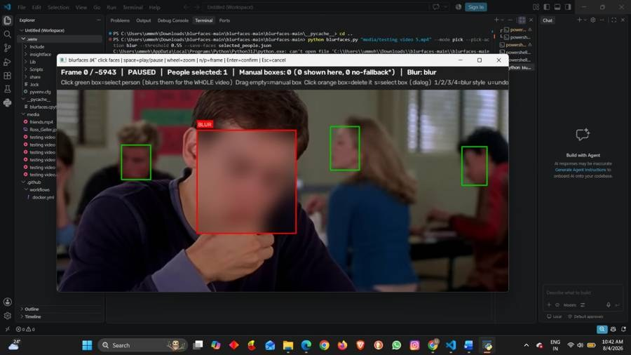
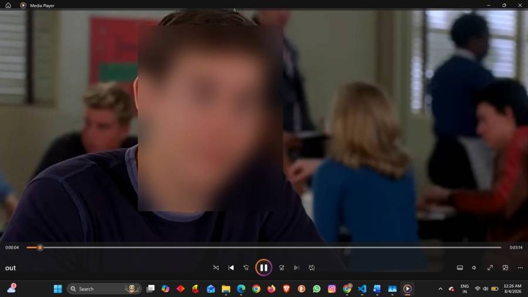
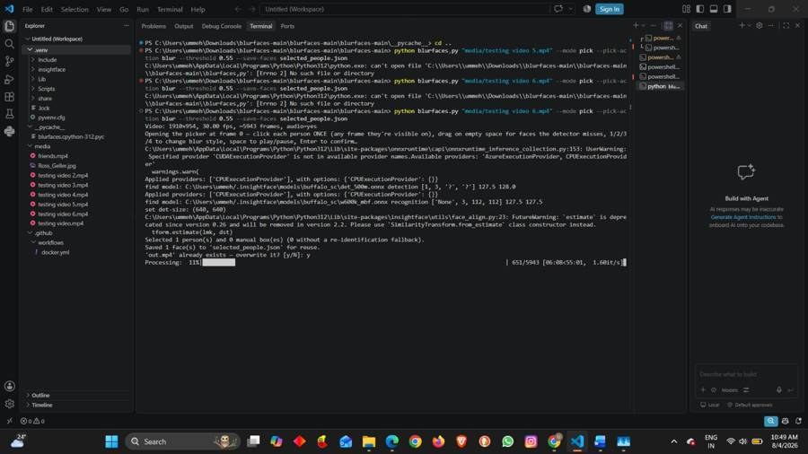
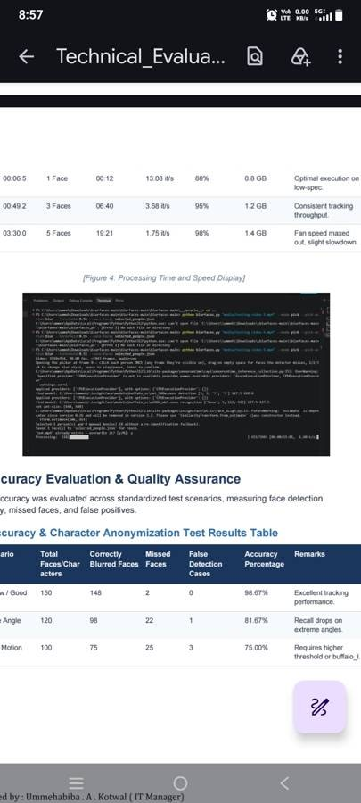
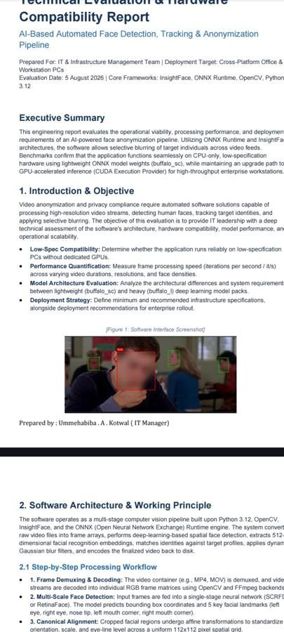

+++
contributor = "ummehabiba-kotwal"
title = "Ummehabiba Akeelahmed Kotwal - Week 6"
date = 2026-10-23
draft = false
author = "Ummehabiba Akeelahmed Kotwal"
role = "IT Manager Intern"
week = 6
emoji = "💻"
+++



## 💻 Ummehabiba Akeelahmed Kotwal

### Testing an AI-Based Computer Vision System: BlurFaces

*IT Manager Intern · EdTech Research Internship | Week 6 of 7*

Another technically interesting assignment during my internship was evaluating **BlurFaces**, an AI-based computer vision application for detecting, tracking and anonymizing faces in video.

My role was software testing and evaluation, not development of the BlurFaces system.

#### Understanding the Technology

The software uses computer-vision and AI techniques to identify faces in video and apply anonymization.

During testing, I worked with the software environment and examined functions such as:

- Face detection.
- Target-face selection.
- Face tracking.
- Face anonymization.
- Different blur styles.
- Video processing.
- CPU/GPU execution possibilities.

The technology introduced me to concepts such as computer vision, face embeddings, detection models and inference runtimes.

#### Testing Face Detection

The first test focused on whether faces could be detected correctly in video frames.

Under suitable lighting and normal conditions, the system was able to detect faces.

I then tested the target-selection process, where selected faces could be saved for further processing.

*The face picker: detected faces are outlined in green, and the selected person is marked BLUR in red*

#### Testing Automatic Face Blurring

After selecting the target faces, I tested the processing workflow to generate an anonymized output video.

The result demonstrated how a selected person's face could be blurred automatically throughout the video.

*The processed video with the selected face blurred*

I also tested the tracking behaviour to see whether the blur continued to follow the selected face during movement.

#### Understanding the Interface

I tested controls such as:

- Selecting a face.
- Creating a manual bounding box.
- Removing a selection.
- Changing blur styles.
- Playing and pausing video.
- Saving selections.

This made me realize that testing is not only about checking whether the underlying algorithm works.

The user interface and interaction process also need to be evaluated.

#### Hardware and Performance

I also investigated how performance changes depending on the hardware and AI model being used.

The testing showed that:

- CPU-only processing can be considerably slower.
- Better hardware can improve processing speed.
- GPU acceleration can improve performance where supported.
- Lighting and video quality affect detection.
- Unclear or partially covered faces can be more difficult to detect.
- Large video files require greater processing resources.

*Processing a video of about 5,943 frames on the CPU provider, at roughly 1.6 frames per second*

*Processing time and speed measurements from the technical evaluation report*

*The BlurFaces technical evaluation and hardware compatibility report*

I also explored the use of ONNX Runtime and GPU execution as part of the performance investigation.

#### Privacy and Security

Because the application deals with faces and video, privacy became an important part of the evaluation.

I considered issues such as:

- Protecting processed videos.
- Restricting access to stored face-related information.
- Handling embeddings responsibly.
- Avoiding unnecessary exposure of personal information.
- Considering applicable privacy requirements.

This connected the technical testing with an important real-world question:

> Can an AI system perform its task while handling sensitive information responsibly?

#### What I Learned

Testing BlurFaces gave me practical exposure to an AI application without requiring me to develop the entire system myself.

I learned how to:

- Set up a Python-based software environment.
- Follow a testing workflow.
- Identify expected and actual results.
- Examine failures and limitations.
- Compare behaviour under different conditions.
- Consider hardware dependencies.
- Think about privacy alongside functionality.

It helped me understand that AI systems should be evaluated not only for whether they work, but also for accuracy, performance, usability, limitations and responsible handling of data.

*Written by Ummehabiba Akeelahmed Kotwal, IT Manager Intern. IT Manager internship with Pthoth in collaboration with Swami Vivekanand Seva Pratisthan (SVSP), Belagavi*
