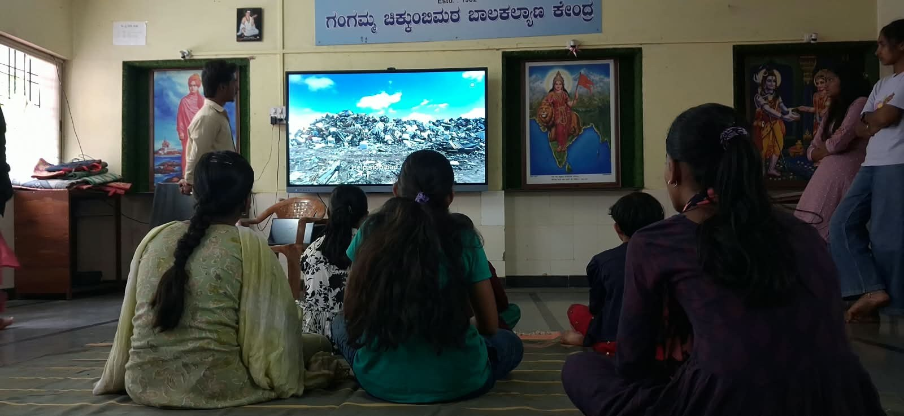
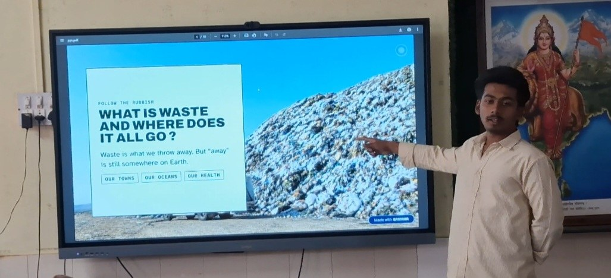

+++
contributor = "vishwas-karikatti"
title = "Vishwas Karikatti - Week 6"
date = 2026-10-23
draft = false
author = "Vishwas Karikatti"
role = "Teacher Intern"
week = 6
emoji = "👨‍🏫"
+++



## 👨‍🏫 Vishwas Karikatti

### Teaching Environmental Awareness Through Smart Board Presentations

*Teacher Intern · Internship Journal | Week 6*

**Branch:** Robotics and Artificial Intelligence · **College:** Maratha Mandal Engineering College · **Organisation:** Pthoth, in collaboration with Swami Vivekanand Seva Pratisthan (SVSP), Belagavi

#### 1. Introduction

In the first week I learned what teaching involves, in the second week I began applying it with better planning and questioning, in the third week I focused on building confidence and student participation, and in the fourth week I used quizzes to make learning fun. In the fifth week I let students touch the smart board and explore a map of India themselves. In the sixth week I wanted to use the same smart board for a topic that matters to every one of us: waste. I prepared a short presentation and a video titled *"What is waste and where does it all go?"* so that the students could see for themselves what happens to the things we throw away, and think about what they can do about it.

#### 2. Objectives for the Week

- To help students understand what waste is and where it goes after we throw it away.
- To use visuals and a video on the smart board so that a serious topic stays interesting.
- To connect the topic to the students' own towns, water and health.
- To encourage small daily habits such as reducing, reusing and segregating waste.
- To keep using mentor feedback to improve my lessons.

#### 3. Activities Undertaken

**Classroom sessions.** Sessions were held at the Kendra, with the students sitting together on the floor in front of the smart board. As in earlier weeks, I planned my questions in advance and kept explanations short and simple, so that the students had time to watch, think and respond.

**Video on the smart board.** I began by playing a short video that showed a huge pile of garbage. Seeing the size of the dump made the students pause and talk among themselves, and it gave me a natural way to start the discussion. I asked them what they thought the pile was made of and where it had come from.

*Figure 1: Students watching a video on waste on the smart board at the SVSP Kendra.*

**Presentation: "Follow the Rubbish".** After the video I presented slides on the smart board. The opening slide asked, *"What is waste and where does it all go?"* and made one clear point: waste is what we throw away, but "away" is still somewhere on Earth. I linked this to three ideas, *our towns, our oceans and our health*, and explained each one with simple examples from daily life.

*Figure 2: Explaining the opening slide of the presentation on the smart board.*

**Facts from a trusted source.** To make the lesson accurate, I used data from the World Bank's *What a Waste* series (see Resources). It reports that the world generated about 2.6 billion tonnes of municipal solid waste in 2022, that food makes up the largest share of it (about 38%), and that without action yearly waste could grow by around 50% by 2050. I shared these numbers in simple words and asked the students to think about how much waste their own homes produce.

**Discussion.** I ended each part with questions such as "What do you throw away every day?" and "Which of these things can be reused?" Students shared ideas, and we talked about separating wet and dry waste and avoiding single-use plastic.

#### 4. What I Learned

- A strong visual or video at the start of a lesson captures attention immediately.
- Students understand big problems better when they are linked to their own surroundings.
- Real data from a trusted source makes a lesson more credible and interesting.
- Asking students what they can do themselves turns awareness into action.
- Regular feedback from mentors helps me improve with every session.

#### 5. Challenges and Improvements

Some statistics and slide text were difficult for the younger students to follow, and a few students found it hard to see the details from the back of the room. Going forward, I plan to use fewer words on each slide, explain numbers with comparisons the students already know, and sit the youngest students closer to the screen. I also want to add a small hands-on activity, such as sorting waste into wet and dry categories, so that students can practise what they learn.

#### 6. Resources

- World Bank – *What a Waste*: global record of solid waste data (generation, composition, collection and disposal for 217 countries and economies): [https://www.worldbank.org/en/publication/what-a-waste](https://www.worldbank.org/en/publication/what-a-waste)
- World Bank blog – Ten Charts that Explain the Global Waste Crisis: [https://blogs.worldbank.org/en/sustainablecities/what-a-waste-3-charts](https://blogs.worldbank.org/en/sustainablecities/what-a-waste-3-charts)

#### 7. Key Takeaway

Week 6 showed me that a smart board is useful not only for activities and quizzes but also for teaching values and awareness. When students see the problem, understand the facts and are asked what they can do, they begin to take responsibility. My confidence and teaching skills continue to grow with every session, and I look forward to learning more from my students and mentors in the coming weeks.
